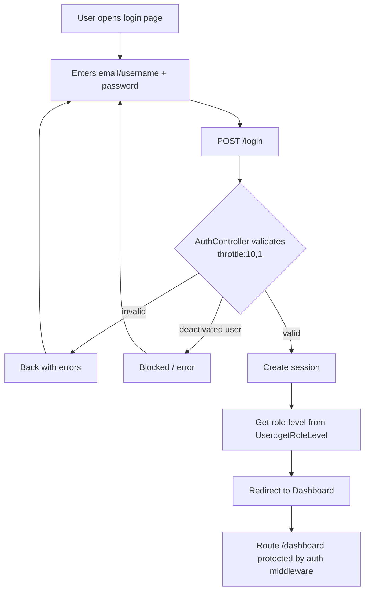
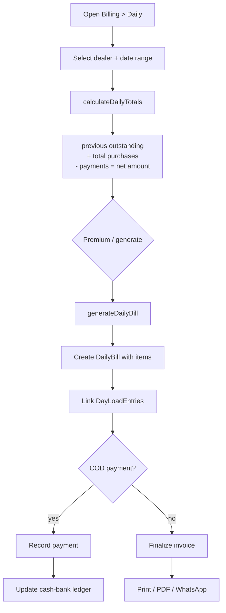
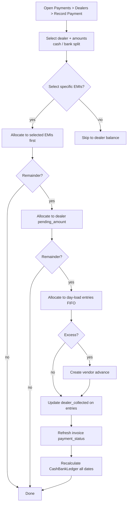
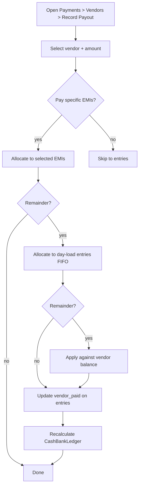
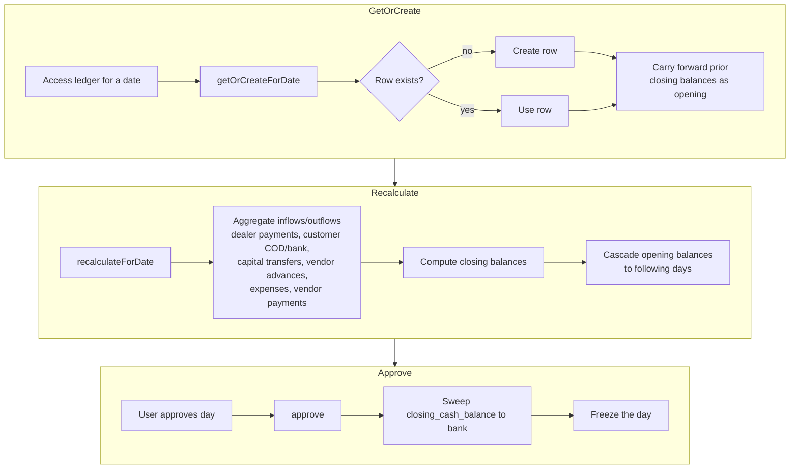

# Application Flows — Flockwise BizTrack / MSR BROILERS

Complete end-to-end application flow analysis. Each major business flow includes a textual step summary and a **Mermaid flowchart** diagram. These diagrams reflect the service-oriented architecture of the codebase (controllers delegate business logic to dedicated `*Service` classes).

---

## 1. Authentication Flow

Session-based authentication via Laravel's built-in web guard. Users may log in with **email or username**; deactivated accounts (`is_active = false`) are blocked. The admin role bypasses permission checks via `Gate::before`.

```
User → Login Page (POST /login) → AuthController@login → Validates → Redirect to Dashboard
```



---

## 2. Customer Management Flow

Full CRUD for customer master data. Deletes are guarded by confirmation dialogs; balances are auto-calculated from billing/payment history.

```
Create: Masters > Customers > Add → Form → POST /customers → CustomerService@create → customers table → Notification
Edit:   Masters > Customers > Edit → Form → PUT /customers/{id} → CustomerService@update → customers table
Delete: Masters > Customers > Delete → Confirm → DELETE /customers/{id} → CustomerService@delete → Redirect
```

```mermaid
flowchart TD
    subgraph Create
        C1[Masters > Customers > Add] --> C2[Fill form]
        C2 --> C3[POST /customers]
        C3 --> C4[CustomerService@create]
        C4 --> C5[customers table]
        C5 --> C6[Success flash / redirect to list]
    end
    subgraph Edit
        E1[Masters > Customers > Edit] --> E2[Pre-fill form]
        E2 --> E3[PUT /customers/{id}]
        E3 --> E4[CustomerService@update]
        E4 --> E5[customers table updated]
    end
    subgraph Delete
        D1[Masters > Customers > Delete] --> D2[SweetAlert confirm]
        D2 -- confirmed --> D3[DELETE /customers/{id}]
        D3 --> D4[CustomerService@delete]
        D4 --> D5[Redirect]
    end
    subgraph View
        V1[Show Customer] --> V2[AJAX tabs]
        V2 --> V3[Billing history]
        V2 --> V4[Payment history]
        V2 --> V5[EMI history]
        V2 --> V6[Ledger PDF]
    end
```

---

## 3. Day-Load Billing Flow (Core Business Flow)

The heart of the system — daily bird loading and delivery with dealer/vendor weight settlement. Multi-step: create a batch for a date, add entries (auto-computed weights/amounts), optional bulk entry, transfers/adjustments, approve weight loss, finalize, record payments, and print.

```
Step 1: Create Batch — billing/day-load → DayLoadBatch (billing_date, status=Open)
Step 2: Add Entries — POST /billing/day-load → DayLoadBillingService@createEntry
  → Creates DayLoadEntry with vendor, dealer, boxes, weights, rates
  → Auto-computes bird_weight, loss_weight, total_weight, amount
  → Logs to EntryAdjustmentLog
  → Refreshes batch totals
Step 3: Bulk Entries — POST /billing/day-load/bulk-store → createBulkEntries
  → Creates multiple entries for one vendor across dealers
Step 4: Transfer/Adjust — Transfer weight between entries, split entries
Step 5: Approve Weight Loss — approve-weight-loss → Creates Expense record
Step 6: Finalize — finalizeInvoice → Creates DayLoadInvoice
Step 7: Record Payments — dealer-payment, vendor-payment
Step 8: Print Invoice — GET /billing/day-load/{date}/print
```

```mermaid
flowchart TD
    A[Open Billing > Day Load] --> B{Select date}
    B --> C[Get or create DayLoadBatch<br/>billing_date, status=Open]
    C --> D[Add entry: vendor, dealer, boxes,<br/>box weight, empty weight, farm weight, rate]
    D --> E[DayLoadBillingService@createEntry]
    E --> F[Auto-compute bird_weight, loss_weight,<br/>total_weight, amount]
    F --> G[Write EntryAdjustmentLog]
    G --> H[Refresh batch totals]
    H --> I{More entries?}
    I -- yes, multiple dealers/vendor --> J[POST /bulk-store]
    J --> K[createBulkEntries for one vendor]
    K --> H
    I -- done --> L{Adjustments needed?}
    L -- yes --> M[Transfer weight between entries / split]
    M --> N[Log adjustment]
    L -- no --> O{Weight loss approved?}
    O -- yes --> P[approve-weight-loss]
    P --> Q[Create Expense record]
    O -- no / done --> R[finalizeInvoice]
    R --> S[Create DayLoadInvoice]
    S --> T[Record dealer-payment / vendor-payment]
    T --> U[Refreshes payment_status on entries]
    U --> V[GET /billing/day-load/{date}/print]
    V --> W[Print / PDF invoice]
```

---

## 4. Weekly Billing Flow

Generates a weekly invoice per dealer for a chosen period, then settles the dealer's `pending_amount`.

```
1. Dealer adds purchases via billing/weekly → WeeklyBillingService@createPurchase
2. Generate Weekly Bill → calculateWeeklyTotals → generateWeeklyBill
3. Links DayLoadEntries for the period
4. Creates WeeklyBill with items, GST, discount
5. Adjusts dealer pending_amount
6. Dealer makes payment → DealerPaymentService@record
```

```mermaid
flowchart TD
    A[Dealer adds purchases] --> B[WeeklyBillingService@createPurchase]
    B --> C[Store purchase]
    C --> D[Open Billing > Weekly]
    D --> E[Select dealer + date range]
    E --> F[calculateWeeklyTotals]
    F --> G[Previous outstanding + purchases - payments]
    G --> H[generateWeeklyBill]
    H --> I[Link DayLoadEntries for period]
    I --> J[Create WeeklyBill with items, GST, discount]
    J --> K[Adjust dealer pending_amount]
    K --> L{Dealer pays?}
    L --> M[DealerPaymentService@record]
    M --> N[Update dealer ledger / cash-bank]
    L --> O[Print / PDF / WhatsApp]
```

---

## 5. Daily Billing Flow

Generates a daily invoice for a dealer covering a given date range, and records a COD payment when applicable.

```
1. Select dealer + date range
2. calculateDailyTotals → previous outstanding, total purchases, payments, net amount
3. generateDailyBill → Creates DailyBill with items
4. Links DayLoadEntries
5. Records payment if COD
```



---

## 6. Purchase Flow

Records a vendor purchase with optional GST, auto-creates inventory items if they are new, and (when relevant) schedules EMI payments.

```
Purchase Entry → POST /purchases → PurchaseService@create
  → Creates Purchase + PurchaseItems
  → Auto-creates Items if new
  → Records stock in (StockService@recordIn)
  → Creates Expense for purchase amount
  → Recalculates CashBankLedger
  → Optionally creates EMI schedule
```

```mermaid
flowchart TD
    A[Open Purchases > Entry] --> B[Select vendor, invoice no,<br/>date, payment mode]
    B --> C[Add line items: item, qty, rate, unit]
    C --> D[POST /purchases]
    D --> E[PurchaseService@create]
    E --> F[Create Purchase + PurchaseItems]
    F --> G{New item?}
    G -- yes --> H[Auto-create Items]
    G -- no --> I[Use existing item]
    H --> J[StockService@recordIn<br/>stock in]
    I --> J
    J --> K[Create Expense for purchase amount]
    K --> L[Recalculate CashBankLedger]
    L --> M{"Pay later"?}
    M -- yes --> N[Create EMI schedule]
    M -- no --> O[Ledger payment]
    N --> P[Invoices archive / print / PDF]
    O --> P
```

---

## 7. Dealer Payment Flow (Complex Allocation)

Dealer payments are allocated in a defined priority order: selected EMIs first, then dealer `pending_amount`, then day-load entries in FIFO order; any excess becomes a vendor advance.

```
Dealer Payment → DealerPaymentService@record
  → Allocates to selected EMIs first
  → Then to dealer pending_amount
  → Then to day-load entries (FIFO order)
  → Excess creates vendor advance
  → Updates dealer_collected on entries
  → Refreshes invoice payment_status
  → Recalculates CashBankLedger for all dates
```



---

## 8. Vendor Payment Flow

Similar allocation priority to dealer payments but toward vendors: selected EMIs, then day-load entries FIFO, then the vendor's outstanding balance.

```
Vendor Payment → VendorPaymentService@record
  → Allocates to selected EMIs first
  → Then to day-load entries (FIFO)
  → Remainder against vendor balance
  → Updates vendor_paid on entries
  → Recalculates CashBankLedger
```



---

## 9. Customer Payment Flow

Records a customer's COD and/or bank-transfer amount, optionally as an advance, then adjusts the customer's outstanding balance.

```
Customer Payment → CustomerPaymentService@record
  → Creates CustomerPayment with cod_amount + bank_transfer_amount
  → Decrements customer balance (for Advance type)
  → Stores balance_after
  → Recalculates CashBankLedger
```

```mermaid
flowchart TD
    A[Open Payments > Customers > Record Payment] --> B[Select customer]
    B --> C[Enter COD amount / bank transfer amount]
    C --> D[Choose mode: Cash or Bank Transfer]
    D --> E[Select type: Full / Part / Advance /<br/>Regular / Adjustment / Opening]
    E --> F[CustomerPaymentService@record]
    F --> G[Create CustomerPayment<br/>cod_amount + bank_transfer_amount]
    G --> H{Advance type?}
    H -- yes --> I[Decrement customer balance]
    H -- no --> J[Store balance_after]
    I --> J
    J --> K[Recalculate CashBankLedger]
```

---

## 10. Cash/Bank Ledger Flow

Maintains a daily cash & bank ledger: gets/creates a row per date, carries forward prior-day closing balances, and can be "approved" to sweep cash into the bank and freeze the day.

```
CashBankLedgerService@getOrCreateForDate
  → Gets or creates ledger row for date
  → Carries forward previous day's closing balances

CashBankLedgerService@recalculateForDate
  → Aggregates: dealer payments, customer COD/bank, capital transfers, vendor advances, expenses/vendor payments
  → Computes closing balances
  → Cascades opening balances to following days

CashBankLedgerService@approve
  → Sweeps closing_cash_balance into bank
  → Freezes the day
```



---

## 11. Expense & EMI Flow

Creates expenses (with a category) and EMI schedules (loan + monthly installments), then tracks payments against each EMT down to full closure.

```
Create Expense → POST /expenses → ExpenseService@createExpense → expenses table → recalculates ledger
Create EMI    → POST /expenses/emis/emis → emis table with schedule
Pay EMI       → PUT /expenses/emis/emis/{emi}/pay → Updates paid_amount, status
Close EMI     → PUT /expenses/emis/emis/{emi}/close-full → Sets paid_amount = amount
```

```mermaid
flowchart TD
    subgraph Expense
        X1[Expenses > Add Expense] --> X2[Category, description,<br/>amount, date, method]
        X2 --> X3[POST /expenses]
        X3 --> X4[ExpenseService@createExpense]
        X4 --> X5[expenses table]
        X5 --> X6[Recalculate cash-bank ledger]
    end
    subgraph EMI
        E1[Expenses > EMIs > Create] --> E2[Loan name, bank, amount,<br/>due dates, installments]
        E2 --> E3[POST /expenses/emis/emis]
        E3 --> E4[emis table with schedule]
        E4 --> E5{Installment due?}
        E5 -- Pay --> E6[PUT .../emi/{id}/pay]
        E6 --> E7[Update paid_amount, status]
        E5 -- Close full --> E8[PUT .../emi/{id}/close-full]
        E8 --> E9[Set paid_amount = amount]
        E7 --> E10[Alerts for upcoming/overdue]
        E9 --> E10
    end
```

---

## 12. Inventory Management Flow

Covers master data (items), flock lifecycle (batches), stock in/out movements, daily consumptions, and mortalities.

```
Item Master     → CRUD /inventory/items → items table
Batch           → CRUD /inventory/batches → batches table
Stock In        → StockService@recordIn → stock_transactions + stock_ledgers + stock_items
Stock Out       → StockService@recordOut → stock_transactions + stock_ledgers + stock_items
Consumption     → POST /inventory/consumptions → poultry_consumptions → stock deduction
Mortality       → POST /inventory/mortalities → poultry_mortalities → batch count reduction
```

```mermaid
flowchart TD
    subgraph Masters
        M1[Inventory > Items CRUD] --> M2[items table]
        M3[Inventory > Batches CRUD] --> M4[batches table]
        M5[Inventory > Warehouses CRUD] --> M6[warehouses table]
    end
    subgraph Movements
        S1[Stock In] --> S2[StockService@recordIn]
        S2 --> S3[stock_transactions]
        S2 --> S4[stock_ledgers]
        S2 --> S5[stock_items]
        S6[Stock Out] --> S7[StockService@recordOut]
        S7 --> S8[stock_transactions + ledgers + items]
    end
    subgraph DailyOps
        D1[Consumption] --> D2[POST /inventory/consumptions]
        D2 --> D3[poultry_consumptions]
        D3 --> D4[Stock deduction]
        D5[Mortality] --> D6[POST /inventory/mortalities]
        D6 --> D7[poultry_mortalities]
        D7 --> D8[Batch count reduction]
    end
    subgraph Analytics
        A1[Inventory analytics] --> A2[Chart.js views]
    end
    Masters --> Movements
    Movements --> DailyOps
    DailyOps --> Analytics
```

---

## 13. Report Generation Flow

Report pages aggregate data through `ReportService`, and PDF/CSV exports are produced via DOM PDF and a streaming CSV exporter.

```
Report Page   → ReportController@index → ReportService@getIndexSummary
Sales Reports → ReportService@getDailySales / WeeklySales / MonthlySales
PDF Export    → ReportService@generateSalesPDF / PurchasesPDF → dompdf download
CSV Export    → ExportService@streamCsv → streamed download
```

```mermaid
flowchart TD
    A[Open Reports] --> B[ReportController@index]
    B --> C[ReportService@getIndexSummary]
    C --> D{Report type}
    D -- Sales --> E[getDailySales / getWeeklySales / getMonthlySales]
    D -- Purchases --> F[getDailyPurchases / getWeeklyPurchases / getMonthlyPurchases]
    D -- Ranking --> G[Customer ranking]
    D -- Vendor --> H[Vendor analytics]
    D -- Purchase analytics --> I[Purchase analytics]
    E --> J{Export?}
    F --> J
    G --> J
    H --> J
    I --> J
    J -- PDF --> K[generateSalesPDF / generatePurchasesPDF -> dompdf]
    J -- CSV --> L[ExportService@streamCsv streamed download]
    K --> M[Download]
    L --> M
    J -- on-screen --> N[Render table/charts]
```

---

## 14. Profit Analysis Flow

Profit module breaks down weekly income vs expenses, monthly trends, order-wise and batch-wise profitability, and can export.

```
Profit Index → ProfitService@getWeeklyBreakdown
Monthly      → ProfitService@getMonthlyTrend
Export       → ExportService@streamCsv or ProfitService PDF
```

```mermaid
flowchart TD
    A[Open Profit] --> B[ProfitService@getWeeklyBreakdown]
    B --> C{Which view?}
    C -- Weekly --> D[Weekly detail breakdown]
    C -- Monthly --> E[ProfitService@getMonthlyTrend<br/>monthly revenue vs costs]
    C -- Expense vs Income --> F[Comparison chart]
    C -- Order-wise --> G[Order-wise profit]
    C -- Batch --> H[Batch-wise profit]
    C -- Compare --> I[Period/entity comparison]
    C -- Export --> J[ExportService@streamCsv / ProfitService PDF]
    J --> K[Download CSV / PDF]
```

---

## Cross-Cutting Notes

- **Service layer:** Business logic lives in dedicated services (e.g. `DayLoadBillingService`, `DealerPaymentService`, `VendorPaymentService`, `CustomerPaymentService`, `CashBankLedgerService`, `StockService`, `ExpenseService`, `ProfitService`, `ReportService`, `ExportService`); controllers remain thin.
- **Ledger cascade:** Many payment/billing flows end by recalculating `CashBankLedger` across affected dates — the closing balance of one day becomes the opening balance of the next.
- **AJAX tabs:** Detail views (customer show, reports) load sub-sections via AJAX (empty layout) with prefetch + caching (see `docs/10-javascript-functions.md`).
- **Confirmation & flash UX:** Destructive actions use SweetAlert2 confirmations (from native `confirm()`), and every flow returns success/error flash messages via SweetAlert2.
