# MSR BROILERS MANAGEMENT SYSTEM
# FLOCKWISE BIZTRACK
# COMPLETE USER GUIDE

**Subtitle:** A Complete Step-by-Step Guide for Daily Poultry Farm and Business Operations  
**Document Version:** 1.0  
**Document Date:** September 4, 2026  
**Application Name:** Flockwise BizTrack (MSR BROILERS Management System)  
**Prepared For:** Business Owners, Farm Managers, Accounts, Billing, Inventory, and Field Operations Staff  

---

## Welcome to Flockwise BizTrack

Welcome to the **Flockwise BizTrack Complete User Guide**. 

Flockwise BizTrack is an integrated business management platform purpose-built for commercial broiler poultry farming and distribution. The system unites every facet of daily poultry farm operations into a single, cohesive workflow:
* **Business Partner Directory:** Managing customers, dealers, vendors, and transport routes.
* **Day-Load Operations:** Daily bird harvesting, crate weighing, weight loss tracking, and load settlement.
* **Billing & Invoicing:** Generating daily and weekly bills with tax (GST) and discount calculations.
* **Procurement:** Managing feed, chicks, medicines, vaccines, and equipment purchases from suppliers.
* **Financial Settlements:** Handling customer collections, dealer payments with automatic FIFO debt clearing, vendor payouts, and advance credits.
* **Flock & Inventory Management:** Tracking bird batches, feed consumption, mortality counts, warehouse stock, and low-stock alerts.
* **Accounting & Treasury:** Managing daily cash and bank balances, operational expenses, loan EMI schedules, and capital investments.
* **Business Analytics:** Real-time visibility into batch performance, sales trends, purchase costs, and profitability.
* **Administration:** Secure role-based user management and comprehensive activity logs.

This manual is written in simple, clear business language. It contains step-by-step instructions designed to help both newly hired employees and seasoned team members operate the software quickly and error-free.

To navigate the software efficiently, always refer to the exact module names displayed in your left-hand application menu.

---

## Table of Contents

1. [Login and Getting Started](#1-login-and-getting-started)
   * 1.1 How to Access the Application
   * 1.2 Step-by-Step Login Procedure
   * 1.3 User Roles and Access Levels
   * 1.4 Post-Login Experience
   * 1.5 Handling Login Failures
   * 1.6 How to Log Out Securely
2. [Dashboard Overview](#2-dashboard-overview)
   * 2.1 Dashboard Purpose
   * 2.2 Key Performance Cards
   * 2.3 Sales and Purchase Analytical Charts
   * 2.4 Operational Alerts and Notifications
   * 2.5 Recent Transactions Feed
3. [Sidebar Navigation Reference](#3-sidebar-navigation-reference)
   * 3.1 Main Navigation Structure
   * 3.2 Secondary and Direct Module Links
4. [Common Screen Features and Navigation Controls](#4-common-screen-features-and-navigation-controls)
   * 4.1 Global Search and Module Search
   * 4.2 Column Sorting and Filters
   * 4.3 Table Pagination
   * 4.4 Action Buttons: Add, Edit, View, and Delete
   * 4.5 Confirmation Dialogs and Success Banners
   * 4.6 Status Badges and Color Codes
   * 4.7 Exporting Data (PDF and CSV)
   * 4.8 Printable Invoice Layouts
5. [Masters Management](#5-masters-management)
   * 5.1 Customers Master
   * 5.2 Dealers Master
   * 5.3 Vendors Master
   * 5.4 Delivery Routes and Fleet Management
6. [Dayload Billing Operations](#6-dayload-billing-operations)
   * 6.1 Purpose of Day-Load Operations
   * 6.2 Understanding Crates, Weights, and Rate Margins
   * 6.3 Creating or Opening a Daily Batch
   * 6.4 Recording Individual Loading Entries
   * 6.5 Fast Data Entry via Bulk Store
   * 6.6 Weight Transfers and Entry Splitting
   * 6.7 Weight Loss Settlement and Expense Approval
   * 6.8 Finalizing the Day-Load Invoice
   * 6.9 Recording Direct Collections and Payouts
   * 6.10 Printing and Exporting Day-Load Invoices
7. [Billing & Invoicing Operations](#7-billing--invoicing-operations)
   * 7.1 Daily Billing Generate
   * 7.2 Weekly Billing Generate
   * 7.3 Cash & Bank Ledger
8. [Purchases Management](#8-purchases-management)
   * 8.1 Recording a Purchase Entry
   * 8.2 Adding Purchase Line Items and Tax
   * 8.3 Payment Options and EMI Scheduling
   * 8.4 Purchase Invoices Archive and PDF Statements
9. [Payments Management](#9-payments-management)
   * 9.1 Customer Payments
   * 9.2 Dealer Payments & Multi-Tier FIFO Allocation
   * 9.3 Vendor Payments
   * 9.4 Managing Vendor Advances
10. [Inventory & Flock Management](#10-inventory--flock-management)
    * 10.1 Items Catalog
    * 10.2 Bird Batches
    * 10.3 Warehouses
    * 10.4 Stock Levels and Movement History
    * 10.5 Daily Feed & Medicine Consumptions
    * 10.6 Bird Mortalities Tracking
    * 10.7 Flock Analytics
11. [Finance & Treasury](#11-finance--treasury)
    * 11.1 Operational Expenses
    * 11.2 Expense Categories
    * 11.3 Loan EMI Records & Schedules
    * 11.4 Capital & Investment Transactions
    * 11.5 Profit & Loss Analysis
12. [Reports & Analytics](#12-reports--analytics)
    * 12.1 Reports Overview
    * 12.2 Sales Reports (Daily, Weekly, Monthly)
    * 12.3 Purchases Reports (Daily, Weekly, Monthly)
    * 12.4 Customer Ranking Report
    * 12.5 Vendor and Purchase Analytics
13. [Administration & User Security](#13-administration--user-security)
    * 13.1 User Account Management
    * 13.2 Role Configuration
    * 13.3 Permission Groups and Matrix
    * 13.4 Activity Audit Trail
14. [Complete Daily Business Workflows](#14-complete-daily-business-workflows)
    * Workflow 1: Customer Onboarding and Sales Lifecycle
    * Workflow 2: Dealer Onboarding and Periodic Billing
    * Workflow 3: Vendor Onboarding and Supply Procurement
    * Workflow 4: Daily Bird Loading & Dayload Billing (Core Operation)
    * Workflow 5: Vendor Purchase to Warehouse Stock-In
    * Workflow 6: Daily Feed & Medicine Consumption
    * Workflow 7: Bird Mortality Tracking & Flock Update
    * Workflow 8: Dealer Payment Receipt & Multi-Tier FIFO Allocation
    * Workflow 9: Vendor Payout & Advance Credit Adjustment
    * Workflow 10: Daily Cash and Bank Settlement & Ledger Approval
    * Workflow 11: Expense Recording & Loan EMI Servicing
    * Workflow 12: Business Profitability & Periodic Reporting
15. [Master Field Reference](#15-master-field-reference)
16. [Master Status Reference](#16-master-status-reference)
17. [Error and Validation Guide](#17-error-and-validation-guide)
18. [Troubleshooting Guide](#18-troubleshooting-guide)
19. [Security and Important Administrator Notes](#19-security-and-important-administrator-notes)
20. [Workflows Requiring Business Confirmation](#20-workflows-requiring-business-confirmation)

---

## 1. Login and Getting Started

### 1.1 How to Access the Application
Flockwise BizTrack is an enterprise web application hosted on your local farm network or cloud server. To launch the application:
1. Open a modern web browser (Google Chrome, Microsoft Edge, Mozilla Firefox, or Safari).
2. Enter the designated application URL provided by your system administrator (e.g., `http://localhost:8000` or your company domain).
3. The secure login screen will appear, displaying the MSR Broilers emblem and login prompt.

---

### 1.2 Step-by-Step Login Procedure
Follow these steps to log into your account:
1. Locate the **Email or Username** field on the sign-in card.
2. Type your registered email address or official username.
3. Move to the **Password** field and type your password.
4. Click the green **Sign In** (or **Login**) button.
5. The system verifies your credentials. Upon successful authentication, your active session is initialized and you are immediately directed to the **Dashboard**.

---

### 1.3 User Roles and Access Levels
The system implements role-based access control (RBAC). Every staff member is assigned a specific role that dictates which menus, forms, and buttons are visible:

| Role Name | Authority Level | Primary Responsibilities |
|---|:---:|---|
| **Admin** | Level 4 | Complete system ownership. Can view, create, edit, and delete all records, configure user accounts, assign roles, inspect activity logs, and approve financial settlements. |
| **Manager** | Level 3 | Operational leadership. Oversees day-load operations, approves billing, reviews purchases, monitors stock levels, and inspects profit metrics. |
| **Accountant** | Level 3 | Financial specialist. Enters dealer collections, vendor payments, approves daily cash/bank ledgers, records expenses, services EMIs, and compiles tax reports. |
| **Staff** | Level 2 | Daily operations staff. Adds day-load records, enters customer orders, logs consumptions and mortalities, and creates purchase entries. |
| **Data Entry** | Level 2 | Focused on rapid clerical record creation (customer forms, weighing logs, vendor receipts). |
| **Delivery Staff** | Level 2 | Logistics team. Accesses vehicle and route schedules, confirms crate counts, and checks delivery locations. |
| **Viewer** | Level 1 | Read-only access. Can inspect reports, dashboards, and transaction history without permission to create, edit, or delete data. |

---

### 1.4 Post-Login Experience
Once logged in, your browser window displays three persistent structural regions:
1. **Left-Hand Navigation Sidebar:** Contains the branded header (**MSR BROILERS — Management**), all primary module links grouped under clear section headers, and your user profile card at the bottom.
2. **Top Header Bar (Topbar):** Displays a mobile menu toggle button (on smaller screens), the **Global Search** input box, an interactive **Notifications Bell** with an unread badge counter, and your user avatar.
3. **Main Content Workspace:** The central area where dashboards, data tables, entry forms, invoices, and analytical reports are displayed.

---

### 1.5 Handling Login Failures
If you are unable to log in, consider the following causes and solutions:
* **Incorrect Password or Username:** Double-check your spelling and caps lock key. An error message will notify you if credentials do not match.
* **Rate Limiting Security (Too Many Attempts):** If ten consecutive incorrect attempts occur within 60 seconds, the system temporarily locks out further attempts for one minute to protect against unauthorized access. Wait one minute before re-trying.
* **Deactivated Account:** If your user profile has been deactivated by an administrator, the login screen will display an alert stating your account is inactive. Contact your farm manager or administrator to restore your account.
* **Forgotten Password:** Contact your system administrator to reset your password and verify your account status.

---

### 1.6 How to Log Out Securely
Always end your working session before leaving your computer unattended:
1. Move your mouse to the bottom of the left-hand navigation sidebar.
2. Locate the user card showing your name and avatar.
3. Click the red **Logout** button (door/arrow icon).
4. Your active session will terminate immediately, and you will be redirected to the public login screen.

---

## 2. Dashboard Overview

### 2.1 Dashboard Purpose
The **Dashboard** serves as the central command center for MSR Broilers. It provides executive summaries, real-time revenue indicators, active batch counts, financial liabilities, and immediate operational warnings.

---

### 2.2 Key Performance Cards
Located across the top of the dashboard, these interactive cards summarize current operations:

1. **Today's Revenue:** Displays the gross sales value generated from today's bird loads and deliveries. Use this to track daily turnover against targets.
2. **Total Customers:** Shows the aggregate number of active retail and wholesale poultry customers registered in the system.
3. **Pending Payments:** Shows the total outstanding debt owed by dealers and customers across all unsettled bills. Click this card to open the collections list.
4. **Monthly Revenue & Purchases:** Compares the month-to-date sales income against supplier purchase expenses, providing an instant snapshot of monthly operating cash flow.
5. **Active Batches:** Displays the total count of live poultry flocks currently placed in rearing houses across all farm sheds.

---

### 2.3 Sales and Purchase Analytical Charts
The dashboard features dynamic charts that visualize business trajectories:
* **Sales Revenue Trend:** Visualizes daily, weekly, or monthly income from poultry dispatches, allowing managers to spot seasonal peaks and mid-week dips.
* **Procurement Cost Comparison:** Plots purchase expenditure across feed, medicines, and day-old chicks, highlighting expenditure spikes.

---

### 2.4 Operational Alerts and Notifications
The system continuously monitors farm and accounting thresholds, surfacing urgent reminders in the **Alerts** pane:
* **EMI Due Alerts:** Displays loan installments that are scheduled for payment within the next 7 days, as well as overdue installments.
* **Low Stock Warnings:** Alerts warehouse supervisors when vital inventory (such as broiler starter feed or vaccine vials) falls below configured reorder levels.
* **High Pending Balance Reminders:** Flags dealers whose overdue debts have exceeded safe credit limits.

---

### 2.5 Recent Transactions Feed
The lower dashboard table provides a live feed of recent entries:
* Shows recent bird dispatches, purchase entries, and recorded payment collections.
* Each entry displays the transaction date, partner name, type, amount, and payment status badge.
* Clicking any row opens the full underlying transaction document.

---

## 3. Sidebar Navigation Reference

### 3.1 Main Navigation Structure
The sidebar organizes Flockwise BizTrack into logical functional divisions. The exact menu names displayed in the software are documented below:

| Section Header | Menu Item Label | Icon Representation | Purpose & Description |
|---|---|---|---|
| *(Top Items)* | **Dashboard** | `dashboard` | Executive KPIs, revenue stats, charts, and system alerts. |
| *(Top Items)* | **Dayload Billing** | `description` | The core daily bird loading workspace, crate weights, loss settlement, and day-load invoicing. |
| **Master Records** | **Customers** | `group` | Directory of retail and wholesale customers, delivery routes, and ledger balances. |
| **Master Records** | **Dealers** | `local_shipping` | Directory of broiler dealers, contact firms, locations, and pending credit balances. |
| **Master Records** | **Vendors** | `inventory_2` | Directory of feed, chick, and medicine suppliers, shop indicators, and payout ledgers. |
| **Operations** | **Daily Billing Generate** | `receipt` | Creation of daily invoices for dealers/customers covering specific date intervals with tax calculations. |
| **Operations** | **Weekly Billing Generate** | `receipt_long` | Periodic weekly consolidated billing for dealers, linking daily loads, discounts, and payments. |
| **Operations** | **Purchases** | `shopping_cart` | Vendor purchase entry form with line items, tax (GST), and automatic stock-in. |
| **Operations** | **Purchase Invoices** | `receipt` | Historical archive of all vendor purchase invoices grouped by date with PDF export and print capabilities. |
| **Finance & Payments** | **Dealer Payments** | `payments` | Recording incoming dealer collections with automatic FIFO allocation across unpaid day-load entries. |
| **Finance & Payments** | **Vendor Payments** | `credit_card` | Recording payouts to vendors with advance adjustments and balance tracking. |
| **Finance & Payments** | **Cash & Bank Ledger** | `account_balance` | Daily dual-column financial ledger tracking physical cash and bank balances, cascading daily closing balances. |
| **Finance & Payments** | **Capital & Investments** | `savings` | Tracking partner equity injections, capital drawings, and cash/bank inter-account fund transfers. |
| **Finance & Payments** | **Expenses** | `account_balance_wallet` | Recording operational farm expenditures (fuel, labor, utilities, maintenance) categorized by expense head. |
| **Finance & Payments** | **EMI Records** | `notifications_active` | Tracking loan EMI schedules, financier banks, monthly installment dues, and payment closures. |
| **Performance** | **Profit & Loss** | `show_chart` | Comprehensive profitability breakdowns, weekly comparisons, and expense vs. income analytics. |
| **Administration** | **User Management** | `manage_accounts` | Creating system user profiles, assigning roles, and toggling active/inactive access states. |
| **Administration** | **Role Management** | `admin_panel_settings` | Defining authorization roles, security levels, and administrative permissions. |
| **Administration** | **Permissions** | `vpn_key` | Granular permission inspection across functional modules and actions. |

---

### 3.2 Secondary and Direct Module Links
In addition to the primary sidebar items, the following operational modules are accessed via sub-navigation tabs, dashboard widgets, or dedicated links:
* **Inventory (Items, Batches, Warehouses, Stock, Consumptions, Mortalities, Analytics):** Accessible from the operations workspace and global search. Used by farm supervisors for physical flock monitoring.
* **Customer Payments:** Accessible via **Master Records → Customers** (under individual profile action tabs) and the global payments workspace.
* **Delivery Routes & Fleet Management:** Accessible via the Masters hub to configure delivery zones, transport vehicles, and drivers.
* **Business Reports (Sales, Purchases, Customer Ranking, Vendor Analytics):** Accessible via performance summaries and dedicated report generation screens.

---

## 4. Common Screen Features and Navigation Controls

### 4.1 Global Search and Module Search
* **Global Search (Ctrl+K / Cmd+K):** Pressing `Ctrl + K` (or `Cmd + K` on Mac) anywhere in the application opens the global search dialog. Type a customer name, dealer firm, invoice number, or batch code to jump directly to that record.
* **In-Module Table Search:** Every index screen contains a dedicated search box. Entering text automatically filters the table rows without refreshing the page.

---

### 4.2 Column Sorting and Filters
* **Column Sorting:** Clicking sortable column headers (such as Date, Name, Amount, or Status) toggles the listing between ascending and descending order.
* **Date Range Filters:** Dropdown date controls allow you to filter transactions by **Today**, **Yesterday**, **This Week**, **This Month**, or a custom **From Date – To Date** range.
* **Status Dropdowns:** Filter listings to display only records matching a specific operational state (e.g., *Pending*, *Paid*, *Open*, *Invoiced*).

---

### 4.3 Table Pagination
* When lists contain numerous records, the system divides rows across pages (typically 15 to 50 records per page).
* Use the **Previous**, **Next**, and numbered page buttons at the bottom of the table to browse through records. The footer displays the active range (e.g., *"Showing 1 to 25 of 180 records"*).

---

### 4.4 Action Buttons: Add, Edit, View, and Delete
Every data table includes standardized action buttons:
* **Add Record (+ Button):** Positioned at the top-right of the screen to open a new entry form or modal.
* **View (Eye Icon):** Opens the complete profile, detail page, or transaction ledger for the selected record.
* **Edit (Pencil Icon):** Opens the record for modification. Only authorized roles can edit records.
* **Delete (Trash Icon):** Triggers a deletion request. 

---

### 4.5 Confirmation Dialogs and Success Banners
* **SweetAlert2 Confirmation:** Destructive actions (such as deleting a customer or voiding a bill) always display an interactive confirmation modal: *"Are you sure? You will not be able to revert this!"*. You must click **Confirm** to proceed or **Cancel** to abort.
* **Success Flash Banners:** Upon completing an action (creating a bill, saving a payment, updating a master), a green notification banner appears confirming the operation.

---

### 4.6 Status Badges and Color Codes
Visual badges communicate the health of transactions at a glance:
* 🟢 **Green (Paid / Active / Approved / Final):** Transaction fully settled, record active, or balance cleared.
* 🟡 **Amber/Yellow (Pending / Partial / Upcoming / Draft / Open):** Partially settled transaction, pending approval, or awaiting payment.
* 🔴 **Red (Overdue / Cancelled / Inactive / Loss):** Overdue debt, deactivated account, cancelled entry, or weight loss warning.
* 🔵 **Blue/Indigo (Invoiced / Transferred / Bank):** Bill finalized, stock transferred, or bank payment method.

---

### 4.7 Exporting Data (PDF and CSV)
* **Export PDF:** Generates a formatted, publication-quality PDF document suitable for printing or emailing.
* **Export CSV:** Downloads a raw comma-separated spreadsheet file containing all filtered records for analysis in Microsoft Excel or Google Sheets.

---

### 4.8 Printable Invoice Layouts
All billing and purchase screens include a dedicated **Print** action:
* Clicking **Print** formats the document into a clean, black-and-white or high-contrast printable voucher omitting navigation menus.
* Compatible with standard A4 office printers and POS receipt printers.

---

## 5. Masters Management

Masters represent the permanent foundation of your business data. They must be registered before you can create daily sales, purchases, or deliveries.

---

### 5.1 Customers Master

#### Purpose
The **Customers** module manages retail outlets, wholesale buyers, and direct poultry purchasers who buy birds or dressed chicken from MSR Broilers.

#### Who Can Access This Module
* **Admin, Manager, Accountant, Staff:** Full access to create and edit customers.
* **Viewer:** Read-only access to customer directories and ledgers.

#### Where to Find It
**Navigation:** Left Sidebar → **Master Records** → **Customers**

#### Main Screen Overview
* Top bar containing a search box, customer type filter (All / Retail / Wholesale), route filter, and the **Add Customer** button.
* Main table displaying Customer Name, Phone Number, Type Badge, Delivery Route, Current Outstanding Balance, and Action icons.
* Profile modal with AJAX-powered tabs: **Billing History**, **Payment History**, **EMI History**, and **Download Ledger PDF**.

#### How to Add a Customer
1. Navigate to **Master Records → Customers**.
2. Click the green **Add Customer** button in the top-right corner.
3. Complete the form fields:
   * **Customer Name:** Enter the individual or business name *(Required)*.
   * **Phone Number:** Enter the 10-digit mobile number *(Required; must be unique)*.
   * **Customer Type:** Select **Retail** or **Wholesale** from the dropdown *(Required)*.
   * **Delivery Route:** Select an established route or enter a route text description *(Optional)*.
   * **GST Number:** Enter the 15-character GST identification number if applicable *(Optional)*.
   * **Address:** Enter the complete street and delivery address *(Optional)*.
4. Click **Save Customer**.
5. The system validates the entries. If the mobile number is unique, the customer is saved and an immediate confirmation appears.

#### How to Edit a Customer
1. Locate the customer row in the table (use Search if needed).
2. Click the **Edit (Pencil)** icon.
3. Update the required information in the form.
4. Click **Update Customer**.

#### How to Delete a Customer
1. Click the **Delete (Trash)** icon on the customer row.
2. The confirmation dialog will appear. Click **Yes, Delete**.
3. *Note:* The system uses soft deletes. If a customer is linked to historical billing transactions, the record is safely archived rather than permanently purged to safeguard financial integrity.

#### Search and Filters
* Search by customer name or phone number.
* Filter by Customer Type (Retail vs. Wholesale) or Delivery Route.

#### Important Business Rules
* Every customer must have a unique mobile phone number.
* Outstanding balances are calculated automatically by aggregating bills and subtracting all recorded payments and returns.

#### Common Problems
* *Error: "The phone number has already been taken."* The mobile number is already registered to another customer. Search for the phone number to check if an existing profile is already present.

---

### 5.2 Dealers Master

#### Purpose
The **Dealers** module manages registered broiler chicken distributors who receive daily bird dispatches in crates and distribute them across local trade zones.

#### Who Can Access This Module
* **Admin, Manager, Accountant:** Full management and ledger inspection.
* **Staff:** View and basic data entry.
* **Viewer:** Read-only viewing.

#### Where to Find It
**Navigation:** Left Sidebar → **Master Records** → **Dealers**

#### Main Screen Overview
* Table listing: Firm Name, Contact Person, Phone Number, Location, Route, Current Pending Balance (`pending_amount`), and Actions.
* Direct action buttons to view **Purchase History**, **Outstanding Report**, and **Dealer Ledger PDF**.

#### How to Add a Dealer
1. Navigate to **Master Records → Dealers**.
2. Click **Add Dealer**.
3. Fill in the required fields:
   * **Firm Name:** Official trading or shop name *(Required)*.
   * **Contact Person:** Full name of the proprietor or manager *(Required)*.
   * **Phone Number:** 10-digit primary mobile number *(Required)*.
   * **Location / Area:** Town or market district *(Required)*.
   * **Route:** Select the assigned logistics route *(Optional)*.
   * **GST Number:** Dealer's GST number *(Optional)*.
   * **Opening Pending Amount:** If transferring an opening debt, specify the opening balance *(Optional)*.
4. Click **Save Dealer**.

#### How to Edit a Dealer
1. Locate the dealer in the directory.
2. Click the **Edit (Pencil)** icon.
3. Modify contact details, route, or GST number.
4. Click **Update Dealer**.

#### How to Delete a Dealer
1. Click the **Delete** icon. Confirm the prompt.
2. Dealers with active, unsettled day-load bills or historical transactions cannot be permanently removed.

#### Important Business Rules
* The dealer's `pending_amount` reflects cumulative unpaid day-load bird deliveries less recorded payments.
* Payments received from dealers reduce debt based on a multi-tier FIFO allocation sequence.

---

### 5.3 Vendors Master

#### Purpose
The **Vendors** module stores suppliers providing poultry feed, day-old broiler chicks, medicines, veterinary vaccines, brooding equipment, and transport services.

#### Who Can Access This Module
* **Admin, Manager, Accountant:** Full access.
* **Staff:** View and entry based on role.

#### Where to Find It
**Navigation:** Left Sidebar → **Master Records** → **Vendors**

#### Main Screen Overview
* Displays Vendor Firm Name, Contact Person, Phone Number, Shop Indicator badge (*Yes/No*), Route, Cumulative Pending Payable, and Actions.
* Quick links to view **Purchase History**, **Vendor Ledger**, and **Vendor Advance Balance**.

#### How to Add a Vendor
1. Navigate to **Master Records → Vendors**.
2. Click **Add Vendor**.
3. Fill in the form:
   * **Firm Name:** Business or company name *(Required)*.
   * **Contact Person:** Supplier representative name *(Required)*.
   * **Phone Number:** Primary contact number *(Required)*.
   * **Location:** City, town, or warehouse depot *(Required)*.
   * **Is Shop?** Toggle checkbox to indicate whether the vendor operates a physical retail supply store.
   * **GST Number:** Supplier's tax registration number *(Optional)*.
   * **Notes:** Payment terms, bank account details, or delivery lead times *(Optional)*.
4. Click **Save Vendor**.

#### How to Edit a Vendor
1. Locate the vendor and click the **Edit** icon.
2. Make required changes and click **Update Vendor**.

#### How to Delete a Vendor
1. Click **Delete**. Confirm the prompt.
2. Cannot delete vendors linked to existing purchases or day-load entries.

#### Important Business Rules
* When vendor advances are issued, they remain attached to the vendor record as an open credit until adjusted against day-load entries or supply invoices.

---

### 5.4 Delivery Routes and Fleet Management

#### Purpose
Maintains logistics routes, delivery vehicles, and transport drivers responsible for hauling crates from farm sheds to dealer locations.

#### Who Can Access This Module
* **Admin, Manager:** Manage routes, vehicles, and drivers.
* **Delivery Staff, Staff:** View delivery assignments.

#### Where to Find It
**Navigation:** Left Sidebar → **Master Records** → **Routes** (or via Master Settings)

#### How to Add Vehicles, Drivers, and Routes
1. **Add Vehicle:** Enter Vehicle Registration Number (e.g., `TN-XX-XXXX`), Vehicle Type (Pickup / Canter / Truck), and Crating Capacity (number of boxes).
2. **Add Driver:** Enter Driver Name, Mobile Phone Number, and Commercial License Number.
3. **Add Route:** Enter Route Name (e.g., *"Salem South Route"*), geographical Zone, assign the designated Vehicle, and select the assigned Driver. Toggle **Active Status** to on.
4. Click **Save**.

---

## 6. Dayload Billing Operations

### 6.1 Purpose of Day-Load Operations
The **Dayload Billing** module is the central operational hub of MSR Broilers. Every night and early morning, birds are harvested from farm sheds, loaded into plastic crates, weighed, transported, and delivered to dealers. The Dayload module tracks crate tare weights, calculates net bird weight, records farm-to-shop weight shrinkage, applies differential rates, splits entries, approves weight losses, and issues daily invoices.

---

### 6.2 Understanding Crates, Weights, and Rate Margins
To use this module correctly, understand these fundamental poultry terms:
* **No. of Boxes:** The count of transport crates loaded onto the vehicle.
* **Box Weight (Gross Weight):** The combined weight of the transport boxes together with the live birds inside.
* **Empty Weight (Tare Weight):** The weight of the empty plastic boxes alone.
* **Bird Weight (Net Bird Weight):** The net weight of live birds delivered to the dealer.  
  $$\text{Bird Weight} = \text{Box Weight} - \text{Empty Weight}$$
* **Farm Weight:** The weight measured at the farm shed before dispatch.
* **Loss Weight (Transit Shrinkage):** The weight lost during transport due to bird dehydration or excretion.  
  $$\text{Loss Weight} = \text{Farm Weight} - \text{Bird Weight}$$
* **Customer Rate:** The sale price charged per kg to the dealer.
* **Paper Rate:** The market baseline rate per kg set by the poultry federation/vendor.
* **Billing Rate:** The internal accounting rate agreed for the batch.
* **Gross Sale Amount:**  
  $$\text{Amount} = \text{Bird Weight} \times \text{Customer Rate}$$
* **Trading Margin:**  
  $$\text{Margin per kg} = \text{Customer Rate} - \text{Paper Rate}$$

---

### 6.3 Creating or Opening a Daily Batch
1. Click **Dayload Billing** in the left sidebar.
2. The system displays a Date Selector calendar control.
3. Choose the **Billing Date** (defaults to today's date).
4. If a batch exists for that date, it opens automatically. If no batch exists, the system initializes a new **DayLoad Batch** with status **Open**.

---

### 6.4 Recording Individual Loading Entries
1. On the open Dayload board, click **Add Entry**.
2. Complete the entry parameters:
   * **Vendor:** Select the source farm or vendor supplying the birds.
   * **Dealer:** Select the destination dealer receiving the crates.
   * **No. of Boxes:** Enter the number of crates delivered.
   * **Box Weight (kg):** Enter the total gross weight of boxes with birds.
   * **Empty Weight (kg):** Enter the empty crate weight.
   * **Farm Weight (kg):** Enter the weight recorded at farm departure.
   * **Customer Rate (₹/kg):** Enter the price charged to the dealer per kg.
   * **Paper Rate / Billing Rate:** Enter the market reference rate per kg.
   * **Remarks:** Enter any notes regarding bird condition or crate IDs.
3. Notice that as you enter weights, the system automatically computes:
   * **Bird Weight:** `Box Weight - Empty Weight`
   * **Loss Weight:** `Farm Weight - Bird Weight`
   * **Total Entry Amount:** `Bird Weight × Customer Rate`
4. Click **Save Entry**.
5. The entry is added to the board, batch totals update immediately, and an audit entry is created in the adjustment log.

---

### 6.5 Fast Data Entry via Bulk Store
When a single truck carries birds from one farm vendor to multiple dealers along a route, use **Bulk Store**:
1. Click **Bulk Entry** on the Dayload board.
2. Select the common **Vendor** at the top.
3. The screen displays a repeating row grid. For each dealer, enter: Dealer, Boxes, Box Weight, Empty Weight, Farm Weight, and Rate.
4. Click **Save All Entries**. The system creates all records in a single operation and recalculates batch totals.

---

### 6.6 Weight Transfers and Entry Splitting
* **Weight Transfer:** If crates were reassigned from one dealer to another en route, click **Transfer Weight** on the source entry, choose the destination dealer entry, enter the weight to shift, and provide a mandatory reason.
* **Entry Splitting:** If a 20-box delivery must be split into two separate billing rates or dealers:
  1. Click **Split Entry**.
  2. Enter the crate count and bird weight for Child Entry 1 and Child Entry 2.
  3. **Box Conservation Rule:** The sum of boxes in split entries must equal the original entry (e.g., $12 + 8 = 20$). The system rejects entries that fail this validation.
  4. The parent entry is marked **Split**, and two active child entries are created.

---

### 6.7 Weight Loss Settlement and Expense Approval
When transit shrinkage (Loss Weight) occurs, that weight represents monetary loss:
$$\text{Loss Amount} = \text{Loss Weight} \times \text{Agreed Rate}$$
1. Review the **Total Loss Weight** and **Weight Loss Amount** displayed in the batch summary card.
2. An authorized Manager or Admin clicks **Approve Weight Loss**.
3. Upon approval:
   * The system sets `is_weight_loss_approved = true`.
   * An automatic **Expense record** is created under the Operational Expenses ledger for the loss value.
   * The batch is unlocked for final invoicing.

---

### 6.8 Finalizing the Day-Load Invoice
Once all entries and weight adjustments are finalized:
1. Click the green **Finalize Invoice** button.
2. The system locks the batch status from **Open** to **Invoiced**.
3. A consolidated **Day-Load Invoice** is generated with a unique invoice number, total boxes, bird weights, total sales value, and dealer payment balances.

---

### 6.9 Recording Direct Collections and Payouts
You can record payments directly from the Dayload screen without leaving the board:
* **Collect from Dealer:** Click **Collect** next to a dealer line, enter cash or bank transfer amounts, and save. This updates `dealer_collected` and clears that day's pending line.
* **Pay Vendor:** Click **Vendor Payout**, enter the payment amount, and update `vendor_paid`.

---

### 6.10 Printing and Exporting Day-Load Invoices
* Click **Print Invoice** to open the printable invoice format showing crate breakdowns, tare weights, net bird weights, and total amounts.
* Click **Export PDF** to save an electronic PDF statement for WhatsApp or email dispatch.

---

## 7. Billing & Invoicing Operations

### 7.1 Daily Billing Generate

#### Purpose
Generates individual daily tax or standard invoices for dealers covering a specific day or date interval, aggregating daily loads and applying GST if configured.

#### Navigation
Left Sidebar → **Operations** → **Daily Billing Generate**

#### Step-by-Step Instructions
1. Select the **Dealer** from the dropdown.
2. Choose the **Date Range** (From Date and To Date).
3. Click **Preview Daily Totals**.
4. The system calculates:
   * Previous Outstanding Balance
   * Total Purchases (Bird weight × rate) during the day
   * Payments received during the day
   * Net Amount Due
5. Select the **Payment Mode** (Cash, Bank Transfer, or COD).
6. If applicable, verify the **GST Percentage** (defaults to 5% intra-state or 0%).
7. Click **Generate Daily Bill**.
8. A finalized daily bill is created with a unique invoice number. You can print, export to PDF, or generate a WhatsApp statement link.

---

### 7.2 Weekly Billing Generate

#### Purpose
The standard commercial settlement cycle for poultry dealers is weekly. The **Weekly Billing Generate** module consolidates 7 days of bird loads, accounts for mid-week cash collections, factors in weekly volume discounts, and produces an official weekly statement.

#### Navigation
Left Sidebar → **Operations** → **Weekly Billing Generate**

#### Step-by-Step Instructions
1. Select the **Dealer**.
2. Select the **Week Period** (Period Start Date to Period End Date).
3. Click **Calculate Weekly Totals**.
4. The system pulls all linked Day-Load entries for that week and computes:
   * **Opening Outstanding:** Unpaid balance brought forward from prior weeks.
   * **Current Week Deliveries:** Total kg delivered and gross billing amount.
   * **Mid-Week Collections:** Monday through Friday payments recorded.
   * **Volume Discount:** Any approved percentage or flat rupee concession.
   * **Net Closing Outstanding:** Final amount payable.
5. Click **Generate Weekly Bill**.
6. **Actions Available:**
   * **Print Dealer Bill:** Sends the weekly bill to your printer.
   * **Export Dealer Bill PDF:** Downloads an official PDF with MSR Broilers letterhead.
   * **Print All Dealer Bills:** Batch-prints weekly statements for all dealers on that route.
   * **Download Zip:** Downloads all weekly dealer PDFs bundled into a single ZIP archive.

---

### 7.3 Cash & Bank Ledger

#### Purpose
Maintains a strict daily two-column accounting ledger reconciling physical drawer cash against official bank account balances. It ensures that every rupee collected from dealers or paid to vendors is accounted for daily.

#### Navigation
Left Sidebar → **Finance & Payments** → **Cash & Bank Ledger**

#### Daily Ledger Structure
For every calendar date, the ledger calculates:
* **Opening Balances:** Physical Cash Opening + Bank Account Opening (carried forward from the previous day's closing balance).
* **Cash & Bank Inflows:** Dealer payments, customer collections, capital deposits, and cash sales.
* **Cash & Bank Outflows:** Vendor purchase payments, operational expenses, loan EMI deductions, and capital withdrawals.
* **Closing Balances:**  
  $$\text{Closing Cash} = \text{Opening Cash} + \text{Cash Inflows} - \text{Cash Outflows}$$  
  $$\text{Closing Bank} = \text{Opening Bank} + \text{Bank Inflows} - \text{Bank Outflows}$$

#### Cascading Updates
Because closing balances carry forward as the next day's opening balances, updating a historical transaction triggers an automatic cascading recalculation through all subsequent days.

#### Approving and Sweeping Cash into Bank
At the end of the business day:
1. The Accountant or Admin opens the active day's ledger.
2. Verifies physical cash on hand against the **Closing Cash Balance**.
3. Clicks **Approve Ledger**.
4. Any designated surplus physical cash is swept into the bank balance, freezing the day's books against unauthorized tampering.

---

## 8. Purchases Management

### 8.1 Recording a Purchase Entry
When trucks deliver feed bags, medicine boxes, vaccine coolers, or equipment to the farm:
1. Click **Purchases** under the **Operations** section of the sidebar.
2. Complete the purchase header:
   * **Vendor:** Select the supplying vendor.
   * **Invoice Number:** Enter the supplier's printed bill number.
   * **Purchase Date:** Enter the delivery date.
   * **Payment Mode:** Select **Cash**, **Bank Transfer**, or **Pay Later (Credit)**.
   * **GST Percentage:** Enter the applicable tax rate (e.g., 5%, 12%, 18%, or 0%).

---

### 8.2 Adding Purchase Line Items and Tax
1. In the line items section, click **Add Item**.
2. Enter the item details:
   * **Item Name:** Select an existing item from the inventory catalog, or type a new item name. (If you enter a new name, the system automatically registers it in the item master upon saving).
   * **Quantity:** Enter the number of units received.
   * **Unit:** Select `kg`, `Bags`, `Liters`, `Vials`, or `Nos`.
   * **Rate per Unit (₹):** Enter the purchase cost per unit.
3. The system calculates the item subtotal, tax amount, and overall purchase total.
4. Add more lines as needed for mixed deliveries.

---

### 8.3 Payment Options and EMI Scheduling
* If **Cash** or **Bank Transfer** is chosen, the amount is immediately deducted from the Cash & Bank ledger.
* If **Pay Later (Credit)** is chosen, the amount increases the vendor's pending payable balance.
* **EMI Schedule Generator:** For high-value equipment or bulk feed purchases paid in monthly installments, select the EMI checkbox. Specify the financier, down payment, installment count, and monthly due dates. The system automatically creates scheduled EMI records.
5. Click **Save Purchase**.
6. **Automatic System Impacts:**
   * Purchase record created.
   * Stock levels incremented in warehouse inventory.
   * Purchase cost recorded in the expenses ledger.
   * Cash/Bank ledger recalculated.

---

### 8.4 Purchase Invoices Archive and PDF Statements
1. Click **Purchase Invoices** under **Operations** in the sidebar.
2. Browse historical purchases grouped chronologically by date.
3. Click any invoice to view its detailed breakdown.
4. Click **Print** or **Export PDF** to produce documentation for accounting audits.

---

## 9. Payments Management

### 9.1 Customer Payments

#### Purpose
Records collections received from retail and wholesale customers.

#### How to Record a Customer Payment
1. Navigate to **Master Records → Customers** (or the payments hub).
2. Click **Record Payment**.
3. Fill in the details:
   * **Customer:** Select the customer.
   * **Payment Date:** Date of collection.
   * **COD Amount (Cash):** Enter cash received.
   * **Bank Transfer Amount:** Enter bank or UPI transfer received.
   * **Payment Type:** Select **Full**, **Part**, **Advance**, **Regular**, **Adjustment**, or **Opening Balance**.
   * **Notes / Reference Number:** Enter bank transaction ID or remarks.
4. Click **Save Payment**.
5. The customer's outstanding balance decreases immediately, and the Cash/Bank ledger reflects the inflow.

---

### 9.2 Dealer Payments & Multi-Tier FIFO Allocation

#### Purpose
Dealer collections represent the primary cash inflow for MSR Broilers. Because dealers receive deliveries daily and make lump-sum payments periodically, the software uses an automated **multi-tier priority allocation rule (FIFO — First-In, First-Out)** to settle debts accurately.

#### How the Allocation Hierarchy Operates
When you enter a lump-sum dealer payment, the system applies the funds in this exact priority:

```
[Total Payment Received]
          │
          ▼
Priority 1: Selected EMIs (if any specific loan installments were checked)
          │  └── Pays off tagged EMI installments first
          ▼
Priority 2: Dealer Pending Balance (Oldest Historical Ledger Debt)
          │  └── Reduces dealer's general outstanding balance
          ▼
Priority 3: Unpaid Day-Load Entries in Strict Chronological Order (FIFO)
          │  └── Oldest unpaid day-load entry is paid in full
          │  └── Next oldest day-load entry is settled next
          │  └── Repeats until payment funds are exhausted
          ▼
Priority 4: Excess Overpayment
             └── Converted into a Vendor Advance Credit for future use
```

#### Step-by-Step Instructions to Record a Dealer Payment
1. Click **Dealer Payments** under **Finance & Payments** in the sidebar.
2. Click **Record Payment**.
3. Select the **Dealer**.
4. Enter the **Payment Date**.
5. Enter the funds breakdown:
   * **Cash Amount (₹):** Physical cash collected.
   * **Bank Amount (₹):** Digital or cheque transfer received.
   * **Discount Amount (₹):** Any cash discount allowed to the dealer.
6. If the payment was made via bank, select the **Transfer Type** (*UPI, NEFT, RTGS, IMPS, Cheque, Other*) and type the **Reference / UTR Number**.
7. *(Optional)* If specific EMIs are being serviced, check the relevant EMI boxes.
8. *(Optional)* If specific day-load invoices are targeted, select them; otherwise, allow the system's automated FIFO engine to settle the oldest unpaid entries first.
9. Click **Submit Payment**.
10. **System Updates:**
    * Dealer's pending balance is reduced.
    * Line entries transition from *Pending* to *Partially Paid* or *Fully Paid*.
    * Cash & Bank ledger recalculated for all affected dates.
    * An entry is logged in the payment adjustment audit trail.

---

### 9.3 Vendor Payments

#### Purpose
Records outgoing payouts made to feed suppliers, chick hatcheries, and medicine vendors.

#### Allocation Rules
1. Allocates to any selected vendor loan EMIs first.
2. Allocates in FIFO order across unpaid day-load bird procurement entries.
3. Applies remainder against the vendor's general ledger balance.

#### How to Record a Vendor Payout
1. Click **Vendor Payments** under **Finance & Payments** in the sidebar.
2. Click **Record Payout**.
3. Select the **Vendor**, enter the **Date**, and specify the **Cash Amount** and/or **Bank Amount**.
4. Select bank transfer mode and enter the transaction reference code.
5. Click **Submit Payout**. Cash/Bank ledger outflows update immediately.

---

### 9.4 Managing Vendor Advances

#### Purpose
Tracks lump-sum deposits or pre-payments paid to hatcheries and feed mills before goods are delivered.

#### Lifecycle of a Vendor Advance
* **Pending:** Advance paid to vendor; awaiting deliveries.
* **Partially Adjusted:** A portion of the advance has been applied against day-load entries or feed invoices.
* **Fully Adjusted:** The advance is completely exhausted against purchases.

#### How to Issue and Adjust an Advance
1. On the **Vendor Payments** screen, view the **Vendor Advances** tab.
2. Click **Create Advance**, select the vendor, enter amount, mode, and save.
3. When day-load deliveries or feed purchases arrive, click **Adjust Advance** on the open day-load entry to offset the bill against the advance balance without paying fresh cash.

---

## 10. Inventory & Flock Management

### 10.1 Items Catalog
* **Purpose:** Defines all consumable items used in broiler farming.
* **Item Types:**
  * **Feed:** Broiler Pre-Starter, Starter, Finisher crumbles and pellets.
  * **Chick:** Day-old broiler chicks (DOC).
  * **Medicine:** Antibiotics, liver tonics, vitamins, growth promoters.
  * **Vaccine:** Lasota, Gumboro (IBD), Newcastle Disease vials.
  * **Equipment:** Feeders, automatic drinkers, gas brooders, curtains.
  * **Other:** Bedding husk, disinfectants, lime powder.
* **Navigation:** **Inventory → Items**
* **Creating an Item:** Enter Item Name, Code, Type, Brand, Base Unit (`kg`, `bags`, `vials`), and Reorder Warning Level.

---

### 10.2 Bird Batches
* **Purpose:** Tracks the complete biological lifecycle of a flock in a specific farm shed from placement day to final harvest.
* **Navigation:** **Inventory → Batches**
* **Starting a Batch:** Click **Create Batch**. Enter unique Batch Code (e.g., `BATCH-2026-04`), Shed Location, Placement Date, Breed (Cobb 430, Ross 308, Hubbard), Initial Chick Count, and Average Placement Weight.
* **Monitoring:** The batch dashboard continuously displays: Initial Count, Cumulative Mortalities, Feed Consumed, Current Live Count, and Feed Conversion Ratio (FCR).
* **Closing a Batch:** When all birds in the shed have been harvested and sold via Dayload Billing, click **Close Batch**. Record the closure date and final performance metrics.

---

### 10.3 Warehouses
* **Purpose:** Tracks physical storage depots (e.g., *Main Feed Godown, Shed 1 Medicine Store, Farm Cold Room*).
* **Navigation:** **Inventory → Warehouses**
* Add warehouses with name, location, and active status to keep stock segregated across farm sheds.

---

### 10.4 Stock Levels and Movement History
* **Current Stock:** Displays real-time quantity on hand for every item across warehouses.
* **Low Stock Alerts:** Items whose available quantity is at or below their reorder threshold appear highlighted with an amber alert tag.
* **Stock Movements (Ledger):** Every inbound purchase, outbound farm consumption, or stock correction creates an immutable ledger entry showing Date, Item, Type (*IN / OUT / ADJUST*), Quantity, Warehouse, and User.

---

### 10.5 Daily Feed & Medicine Consumptions
* **Purpose:** Records daily bags of feed and medicine doses consumed by each flock batch.
* **Navigation:** **Inventory → Consumptions**
* **How to Log Consumption:**
  1. Click **Log Consumption**.
  2. Select the flock **Batch**.
  3. Select the **Item** (e.g., *Finisher Feed*) and the **Warehouse** it was drawn from.
  4. Enter the **Quantity** (e.g., *15 Bags*).
  5. Enter the date and optional remarks.
  6. Click **Save**. The selected warehouse inventory decreases immediately, and batch feed totals update.

---

### 10.6 Bird Mortalities Tracking
* **Purpose:** Records daily bird deaths to maintain an exact live count and monitor flock health.
* **Navigation:** **Inventory → Mortalities**
* **How to Log Mortality:**
  1. Click **Record Mortality**.
  2. Select the **Batch**.
  3. Enter the **Count** (number of dead birds found during daily shed inspection).
  4. Select the primary **Reason** (*Disease, Heat Stress, Cold/Chilling, Smothering, Unknown, Other*).
  5. Enter veterinary remarks or shed sector details.
  6. Click **Save**. The batch live count reduces automatically.

---

### 10.7 Flock Analytics
Visualizes the performance of live and closed batches. Displays growth weight curves, daily mortality percentages, and feed efficiency indicators.

---

## 11. Finance & Treasury

### 11.1 Operational Expenses
* **Purpose:** Tracks non-procurement overhead expenses necessary to operate the farm and delivery fleet.
* **Navigation:** Left Sidebar → **Finance & Payments** → **Expenses**
* **How to Add an Expense:**
  1. Click **Add Expense**.
  2. Select the **Expense Category** (e.g., *Fuel & Transport, Electricity, Farm Labor Wages, Shed Maintenance, Office Expenses*).
  3. Enter the **Expense Date**.
  4. Enter the **Amount (₹)**.
  5. Select **Payment Method** (*Cash* or *Bank Transfer*).
  6. Enter a clear **Description** (e.g., *"Diesel for TN-28 delivery vehicle - Salem trip"*).
  7. Click **Save Expense**. The expense is logged, appears in P&L, and deducts from the Cash & Bank ledger.

---

### 11.2 Expense Categories
* Navigate to **Expenses → Categories**.
* Create new custom expense categories with custom color indicators to organize farm expenses according to your accountant's chart of accounts.

---

### 11.3 Loan EMI Records & Schedules
* **Purpose:** Tracks long-term farm development loans, tractor/vehicle finance, and equipment EMIs.
* **Navigation:** Left Sidebar → **Finance & Payments** → **EMI Records**
* **Creating an EMI Schedule:**
  1. Click **Create EMI**.
  2. Enter **Loan / Facility Name**, **Bank / Financier Name**, **Total Loan Principal**, and **Interest Rate**.
  3. Configure installment count, monthly payment amount, and repayment start date.
  4. Click **Generate Schedule**.
* **Servicing an Installment:** As installments come due, click **Pay Installment**. Enter the payment date and bank account used. The installment status changes to **Paid**, and the outstanding balance decreases.
* **Closing in Full:** If a loan is foreclosed or paid off in a lump sum, click **Close Full** to settle all remaining installments.

---

### 11.4 Capital & Investment Transactions
* **Purpose:** Tracks owner equity injections, capital withdrawals, and internal transfers between physical drawer cash and bank accounts.
* **Navigation:** Left Sidebar → **Finance & Payments** → **Capital & Investments**
* **Transaction Types:**
  * **Investment:** Owner deposits personal capital into the business (increases Cash or Bank).
  * **Withdrawal:** Owner draws profit or personal funds from the business (decreases Cash or Bank).
  * **Transfer to Bank:** Depositing physical drawer cash into the bank account.
  * **Transfer to Cash:** Withdrawing cash from the bank ATM for farm petty cash.
* Enter the person's name, reference number, date, and amount. Saves directly into daily treasury balances.

---

### 11.5 Profit & Loss Analysis
* **Purpose:** Provides management with real-time profitability figures across operational timeframes.
* **Navigation:** Left Sidebar → **Performance** → **Profit & Loss**
* **Views Available:**
  * **Weekly Detail:** Displays day-by-day revenue from bird sales, vendor bird costs, transport shrinkage expenses, and net weekly gross profit.
  * **Monthly Trend:** Charts monthly turnover against cumulative procurement and operational expenses.
  * **Expense vs. Income:** Visual bar comparison contrasting total farm operational overhead against gross bird sales margins.
  * *Note on Advanced Views:* Certain experimental sub-views (*Order-Wise Profit*, *Entity Comparison*, and *Batch Profit*) are flagged as under construction and will be activated in upcoming releases.

---

## 12. Reports & Analytics

### 12.1 Reports Overview
The **Reports** module provides data exports for tax compliance, sales audits, and vendor reviews. Accessible via **Reports** in the navigation bar.

---

### 12.2 Sales Reports (Daily, Weekly, Monthly)
* **Daily Sales Report:** Itemizes all bird dispatches, weights, rates, and cash collections for any selected day.
* **Weekly Sales Report:** Aggregates weekly dealer invoices, discounts, and outstanding balance movements.
* **Monthly Sales Report:** High-level monthly sales summary for executive management and tax filings.
* **Export Options:** Click **Export PDF** for an official printed summary or **Export CSV** for spreadsheet analysis.

---

### 12.3 Purchases Reports (Daily, Weekly, Monthly)
* Summarizes raw material receipts, feed purchases, and medicine orders.
* Breaks down input tax credit (CGST + SGST) paid to suppliers.
* Available with full date range filters and PDF/CSV export options.

---

### 12.4 Customer Ranking Report
* Ranks poultry customers and dealers by total sales volume (in kg of birds purchased) and total revenue generated.
* Highlights top-performing commercial partners and identifies slow-paying accounts.

---

### 12.5 Vendor and Purchase Analytics
* Analyzes pricing trends per vendor over time.
* Displays feed cost per kilogram history, allowing farm managers to negotiate favorable bulk contracts.

---

## 13. Administration & User Security

### 13.1 User Account Management
* **Purpose:** Controls staff logins, passwords, and security status.
* **Navigation:** Left Sidebar → **Administration** → **User Management**
* **Creating a User:** Click **Add User**, enter Full Name, Email, unique Username, Phone Number, initial Password, and assign an operational Role.
* **Toggling User Status:** To suspend an employee who has left the organization, click **Toggle Status** on their row. Inactive users are immediately barred from logging in.

---

### 13.2 Role Configuration
* **Purpose:** Manages the system's role-based security hierarchy.
* **Navigation:** Left Sidebar → **Administration** → **Role Management**
* Shows system roles (*Admin, Manager, Accountant, Staff, Delivery Staff, Data Entry, Viewer*).
* Custom roles can be created by managers requiring specific operational cross-over duties.

---

### 13.3 Permission Groups and Matrix
* **Navigation:** Left Sidebar → **Administration** → **Permissions**
* Displays the granular permissions controlling access to individual features.
* Permissions follow the naming standard: `{action} {module}` (e.g., `view bills`, `create purchases`, `edit customers`, `manage users`).
* Clicking **Assign Permissions** on any role opens an interactive matrix allowing administrators to check or uncheck individual privileges.

---

### 13.4 Activity Audit Trail
* **Purpose:** Records user actions across the system to maintain security and traceability.
* Accessible to Administrators under **Administration → Activity Logs**.
* Records: User Name, Action Performed (*Create, Edit, Delete, Approve*), Target Module, Record ID, and exact Date & Timestamp.

---

## 14. Complete Daily Business Workflows

This section maps the 12 core operational workflows of MSR Broilers using both visual flowcharts and step-by-step instructions.

---

### Workflow 1: Customer Onboarding and Sales Lifecycle

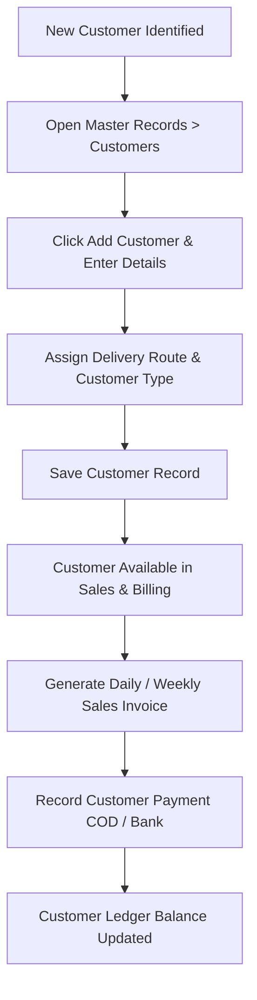

#### Step-by-Step Execution:
1. When a new poultry buyer or retail shop opens an account, the office staff navigates to **Master Records → Customers**.
2. Click **Add Customer** and input Firm Name, unique 10-digit mobile number, delivery address, and type (*Retail* or *Wholesale*).
3. Assign the relevant delivery route to ensure transport logistics are planned properly.
4. Click **Save**. The customer is instantly active.
5. Daily or weekly dispatches are billed against the customer profile.
6. When payment is collected, the cashier opens **Record Payment**, enters cash or bank transfer amounts, and saves.
7. The customer's balance updates automatically, and statements can be generated via **Download Ledger PDF**.

---

### Workflow 2: Dealer Onboarding and Periodic Billing

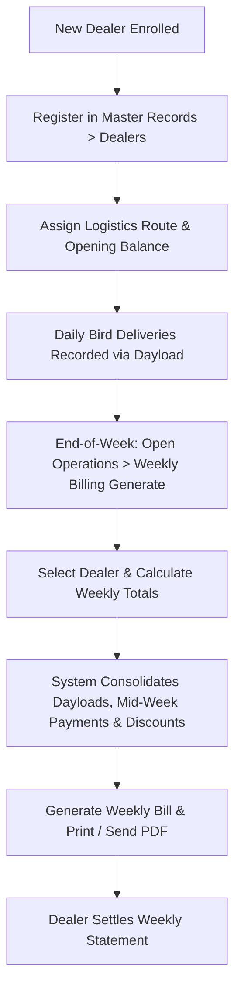

#### Step-by-Step Execution:
1. Register the commercial dealer under **Master Records → Dealers** with firm name, contact person, phone number, and location.
2. Every morning, bird deliveries are logged on the Dayload Billing board against the dealer.
3. At the end of the 7-day trade cycle, the billing accountant opens **Operations → Weekly Billing Generate**.
4. Select the dealer and the week's date range.
5. Click **Calculate Weekly Totals**. The software automatically gathers all daily bird weights, adds prior outstanding debt, subtracts mid-week payments, and applies volume discounts.
6. Click **Generate Weekly Bill**.
7. Print the invoice or export to PDF for immediate WhatsApp sharing.

---

### Workflow 3: Vendor Onboarding and Supply Procurement

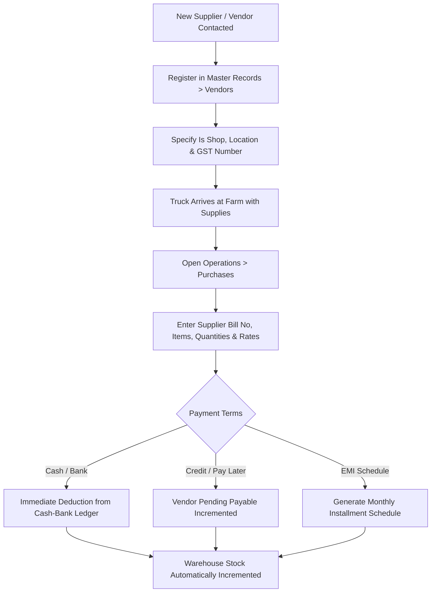

#### Step-by-Step Execution:
1. When purchasing feed or chicks from a new mill or hatchery, create their profile under **Master Records → Vendors**.
2. When the delivery truck arrives at the farm, the inventory clerk opens **Operations → Purchases**.
3. Select the vendor, enter the supplier's printed invoice number, and set the purchase date.
4. Add line items: select feed type, bags received, weight, and rate per unit.
5. Select payment terms: immediate cash, bank transfer, open credit, or loan EMI.
6. Save the purchase. The inventory stock increments automatically, purchase costs flow into the expense ledger, and cash or payable balances update.

---

### Workflow 4: Daily Bird Loading & Dayload Billing (Core Operation)

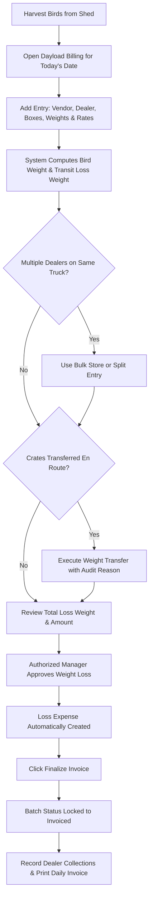

#### Step-by-Step Execution:
1. Harvesting begins in the early hours. Farm supervisors weigh loaded crates and empty crates.
2. The billing clerk opens **Dayload Billing** and selects the current date.
3. For each dealer, click **Add Entry** (or **Bulk Store**): enter Vendor, Dealer, Box Count, Gross Box Weight, Empty Tare Weight, Farm Departure Weight, and Customer Rate per kg.
4. The system automatically computes Net Bird Weight, Loss Weight, and Total Amount.
5. If crates were shifted or shared, use **Transfer Weight** or **Split Entry** (strictly respecting the Box Conservation Rule).
6. Once weighing is complete, the Farm Manager inspects transit shrinkage and clicks **Approve Weight Loss**, which logs the loss expense in the farm accounts.
7. The clerk clicks **Finalize Invoice**, locking the batch and printing the official delivery statements.

---

### Workflow 5: Vendor Purchase to Warehouse Stock-In

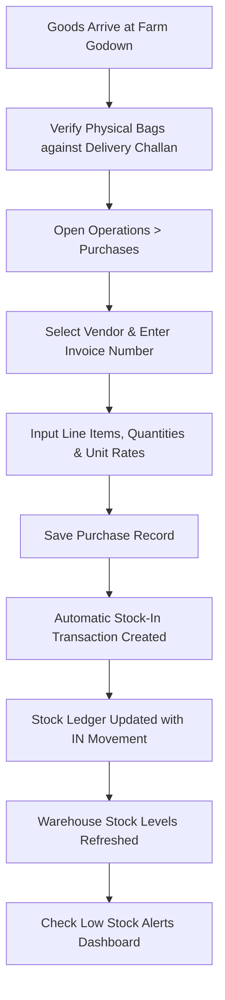

#### Step-by-Step Execution:
1. Unload feed bags or veterinary supplies at the designated farm godown. Verify physical counts against the supplier's challan.
2. In Flockwise BizTrack, navigate to **Operations → Purchases**.
3. Create the purchase entry with supplier details, line items, and units.
4. Upon clicking Save, the system generates an internal **Stock-In** transaction.
5. The warehouse inventory levels update immediately.
6. If an item was previously running low, its amber low-stock alert flag is cleared automatically.

---

### Workflow 6: Daily Feed & Medicine Consumption

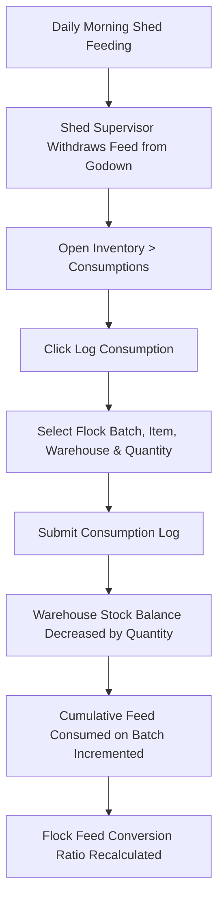

#### Step-by-Step Execution:
1. Daily feed bags and medicine doses are issued from the central godown to individual farm sheds.
2. The supervisor opens **Inventory → Consumptions** and clicks **Log Consumption**.
3. Select the target **Batch Code**, the **Item Name** (e.g., *Broiler Starter*), the **Warehouse**, and enter the **Quantity** (e.g., *20 Bags*).
4. Save the entry.
5. The warehouse inventory decrements by 20 bags.
6. The flock's batch record updates its total feed consumption, updating growth metrics and FCR calculations.

---

### Workflow 7: Bird Mortality Tracking & Flock Update

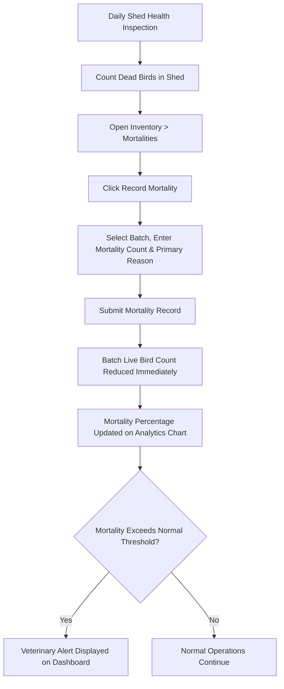

#### Step-by-Step Execution:
1. Farm workers inspect poultry sheds daily and collect any deceased birds.
2. Open **Inventory → Mortalities** and click **Record Mortality**.
3. Select the flock **Batch**, enter the exact count of dead birds, and select the suspected cause (*Heat, Disease, Smothering, etc.*).
4. Save the record.
5. The live bird count for that batch decreases instantly.
6. Mortality curves update on the flock analytics dashboard. If losses spike, managers can dispatch veterinary technicians immediately.

---

### Workflow 8: Dealer Payment Receipt & Multi-Tier FIFO Allocation

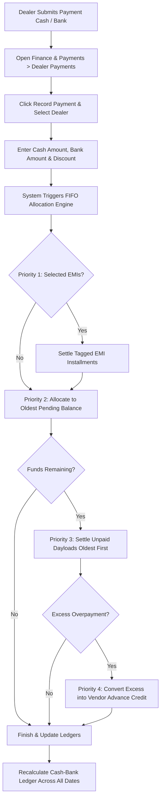

#### Step-by-Step Execution:
1. When a dealer remits funds via cash or bank/UPI, navigate to **Finance & Payments → Dealer Payments**.
2. Click **Record Payment**, select the dealer, and input cash and bank splits.
3. If applicable, enter bank transaction reference codes and any agreed cash discount.
4. Click **Submit Payment**.
5. The system automatically executes the 4-tier FIFO algorithm:
   * Services specific tagged EMIs first.
   * Clears old historical pending debt next.
   * Moves through unsettled day-load deliveries chronologically, marking entries *Partially Paid* or *Fully Paid*.
   * Deposits any excess overpayment into a vendor advance credit.
6. The Cash & Bank ledger recalculates automatically, reflecting updated cash on hand.

---

### Workflow 9: Vendor Payout & Advance Credit Adjustment

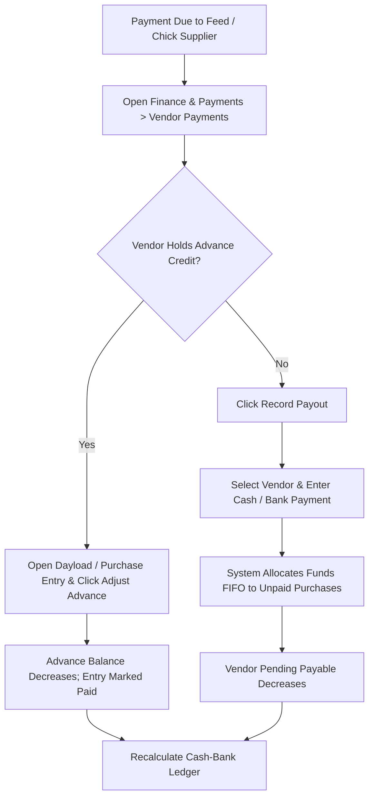

#### Step-by-Step Execution:
1. When paying suppliers, open **Finance & Payments → Vendor Payments**.
2. If an unadjusted advance credit exists, open the pending purchase or day-load entry and click **Adjust Advance** to apply the credit without disbursing cash.
3. If issuing a new cash or bank payout, click **Record Payout**, select the vendor, and enter the amounts.
4. Submit the payout. The system clears open supplier bills in chronological sequence and logs the outflow in the Cash & Bank ledger.

---

### Workflow 10: Daily Cash and Bank Settlement & Ledger Approval

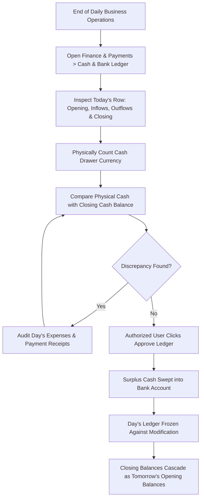

#### Step-by-Step Execution:
1. At the close of each working day, the accountant opens **Finance & Payments → Cash & Bank Ledger**.
2. Locate today's row. Review total cash income (dealer collections, customer sales) and cash expenses.
3. Physically count all cash in the office drawer and verify that it matches the **Closing Cash Balance** on the screen.
4. Once verified, the Accountant or Manager clicks **Approve Ledger**.
5. The system approves the ledger, sweeps designated cash into the bank balance, and freezes the day's books against back-dated modifications.
6. Tomorrow's ledger row is created with opening balances equal to today's closing figures.

---

### Workflow 11: Expense Recording & Loan EMI Servicing

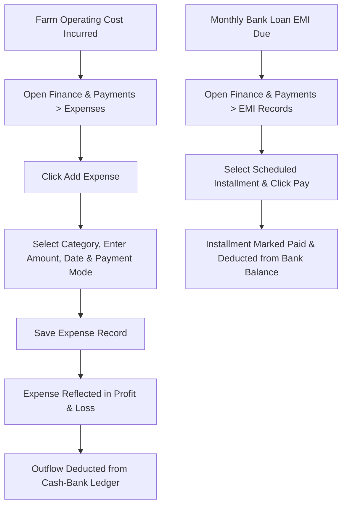

#### Step-by-Step Execution:
1. When operational costs arise (e.g., diesel for delivery vans, electricity bills, shed maintenance materials), open **Finance & Payments → Expenses**.
2. Click **Add Expense**, choose the category, enter the amount, select cash or bank payment, and provide a clear description.
3. Save the expense. It is immediately accounted for in daily cash balances and monthly profit calculations.
4. For loan installments, navigate to **Finance & Payments → EMI Records**, locate the due installment, and click **Pay Installment** to update the loan schedule.

---

### Workflow 12: Business Profitability & Periodic Reporting

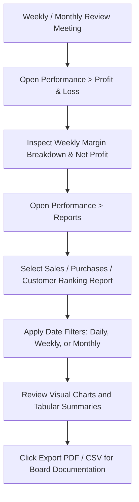

#### Step-by-Step Execution:
1. At the end of each week or month, business owners and managers open **Performance → Profit & Loss**.
2. Review weekly gross margins (bird sales minus vendor bird cost minus transit loss costs) and operating profit.
3. Open **Reports** to inspect sales volume trends, supplier cost movements, and dealer rankings.
4. Export official statements to PDF or CSV for executive board reviews and tax filings.

---

## 15. Master Field Reference

This table provides a comprehensive dictionary of all input fields found across Flockwise BizTrack forms:

| Module | Field Name | What to Enter | Example Value | Mandatory? |
|---|---|---|---|:---:|
| **Customers** | Customer Name | Full legal or trading name of the customer | `Kavitha Broiler Centre` | **Yes** |
| **Customers** | Phone Number | 10-digit mobile phone number (must be unique) | `9842101234` | **Yes** |
| **Customers** | Customer Type | Trading classification | `Retail` or `Wholesale` | **Yes** |
| **Customers** | Delivery Route | Assigned logistics delivery route | `Salem South Route` | No |
| **Customers** | GST Number | 15-character Goods & Services Tax number | `33AAAAA0000A1Z5` | No |
| **Customers** | Address | Physical shop address and location | `14 Market St, Salem` | No |
| **Dealers** | Firm Name | Registered trading name of the dealer | `MSR Sri Murugan Traders` | **Yes** |
| **Dealers** | Contact Person | Name of proprietor or manager | `S. Murugan` | **Yes** |
| **Dealers** | Phone Number | Primary contact mobile number | `9443123456` | **Yes** |
| **Dealers** | Location / Area | City, town, or market hub | `Namakkal West` | **Yes** |
| **Dealers** | Route | Assigned delivery route | `Route 2 - Namakkal` | No |
| **Dealers** | Pending Amount | Opening ledger debt balance (if any) | `25000.00` | No |
| **Vendors** | Firm Name | Registered company name of supplier | `Supreme Feeds Pvt Ltd` | **Yes** |
| **Vendors** | Contact Person | Supplier sales representative | `R. Rajesh` | **Yes** |
| **Vendors** | Phone Number | Contact phone number | `9894056789` | **Yes** |
| **Vendors** | Location | Depot or mill location | `Erode Industrial Estate` | **Yes** |
| **Vendors** | Is Shop? | Whether vendor has a retail store counter | Checked / Unchecked | No |
| **Dayload** | Billing Date | Date birds are harvested and loaded | `2026-09-04` | **Yes** |
| **Dayload** | Vendor | Source farm or supplier of the birds | Select from dropdown | **Yes** |
| **Dayload** | Dealer | Destination dealer purchasing birds | Select from dropdown | **Yes** |
| **Dayload** | No. of Boxes | Count of crates loaded onto the truck | `45` | **Yes** |
| **Dayload** | Box Weight (kg) | Total gross weight of boxes with birds | `1250.50` | **Yes** |
| **Dayload** | Empty Weight (kg) | Tare weight of empty plastic crates | `180.00` | **Yes** |
| **Dayload** | Farm Weight (kg) | Gross weight recorded at farm departure | `1085.00` | **Yes** |
| **Dayload** | Customer Rate | Price charged to dealer per kg (₹) | `112.50` | **Yes** |
| **Dayload** | Paper Rate | Market federation reference rate per kg (₹)| `104.00` | **Yes** |
| **Dayload** | Bird Weight | Net live bird weight (`Box - Empty`) | Auto-calculated | *Auto* |
| **Dayload** | Loss Weight | Weight shrinkage (`Farm - Bird`) | Auto-calculated | *Auto* |
| **Purchases** | Vendor | Supplying feed mill or hatchery | Select from dropdown | **Yes** |
| **Purchases** | Invoice Number | Supplier's printed invoice number | `INV-88941` | **Yes** |
| **Purchases** | Purchase Date | Delivery date of supplies | `2026-09-04` | **Yes** |
| **Purchases** | Payment Mode | Method of payment | `Cash`, `Bank`, `Pay Later` | **Yes** |
| **Purchases** | Item Name | Name of supply item | `Broiler Starter Feed` | **Yes** |
| **Purchases** | Quantity | Quantity received | `100` | **Yes** |
| **Purchases** | Unit | Measurement unit | `Bags`, `kg`, `Vials`, `Nos`| **Yes** |
| **Purchases** | Rate per Unit | Cost per unit (₹) | `2150.00` | **Yes** |
| **Purchases** | GST Percentage | Applicable tax percentage | `5.00` | No |
| **Payments** | Date | Date funds were collected or disbursed | `2026-09-04` | **Yes** |
| **Payments** | Cash Amount | Physical cash amount received/paid (₹) | `50000.00` | No |
| **Payments** | Bank Amount | Digital or cheque transfer amount (₹) | `75000.00` | No |
| **Payments** | Transfer Type | Electronic fund transfer mode | `UPI`, `NEFT`, `RTGS`, `Cheque`| If Bank |
| **Payments** | Reference Number | Bank UTR or cheque number | `UTR994821045` | If Bank |
| **Payments** | Discount Amount | Allowed customer or dealer discount (₹) | `1500.00` | No |
| **Inventory** | Item Type | Functional categorization | `Feed`, `Chick`, `Medicine` | **Yes** |
| **Inventory** | Reorder Level | Minimum threshold triggering low stock | `25.00` | No |
| **Batches** | Batch Code | Unique identification code for flock | `BATCH-2026-05` | **Yes** |
| **Batches** | Initial Count | Number of chicks placed in shed | `5000` | **Yes** |
| **Batches** | Breed | Genetic breed of the broiler chicks | `Cobb 430` | **Yes** |
| **Batches** | Placement Date | Date chicks arrived at farm | `2026-09-01` | **Yes** |
| **Expenses** | Category | Operational expense classification head | `Fuel & Transport` | **Yes** |
| **Expenses** | Amount | Monetary cost incurred (₹) | `3200.00` | **Yes** |
| **Expenses** | Description | Purpose or vehicle receipt description | `Diesel for Salem vehicle` | **Yes** |
| **Expenses** | Payment Method | Disbursed via cash or bank account | `Cash` or `Bank Transfer` | **Yes** |

---

## 16. Master Status Reference

This dictionary defines all confirmed operational status codes used across Flockwise BizTrack:

| Module / Entity | Status Name | Visual Badge | Business Meaning | Allowed System Actions |
|---|---|:---:|---|---|
| **Dayload Batch** | `Open` | 🟡 Amber | Batch is actively being loaded; entries can be added, adjusted, transferred, or split. | Add entries, bulk store, split, transfer, approve loss. |
| **Dayload Batch** | `Invoiced` | 🔵 Blue | Batch is finalized; daily invoice has been generated. | Record payments, print invoice, export PDF. |
| **Dayload Batch** | `Locked` | 🟢 Green | Batch is audited and fully closed against all modifications. | View and print only. Cannot edit entries. |
| **Dayload Entry** | `Active` | 🟢 Green | Normal active bird loading entry included in batch totals. | Can be transferred, split, or billed. |
| **Dayload Entry** | `Adjusted` | 🟡 Amber | Entry has undergone weight or rate modification. | History preserved in audit log. |
| **Dayload Entry** | `Split` | 🔵 Blue | Entry was divided into two or more child entries. | Archived as parent; child entries remain active. |
| **Dayload Entry** | `Cancelled` | 🔴 Red | Entry was voided or cancelled by an authorized user. | Excluded from batch totals and invoice calculations. |
| **Dayload Invoice** | `Draft` | 🟡 Amber | Preliminary invoice generated prior to final review. | Can be regenerated or adjusted. |
| **Dayload Invoice** | `Final` | 🟢 Green | Official, sealed invoice document. | Printable and exportable. Cannot be edited directly. |
| **Invoices / Bills** | `Pending` | 🟡 Amber | Bill issued, but payment has not yet been received. | Awaiting payment allocation. |
| **Invoices / Bills** | `Partial` | 🟡 Amber | A portion of the invoice amount has been paid. | Remains open for remaining balance settlement. |
| **Invoices / Bills** | `Paid` | 🟢 Green | Bill is 100% settled with zero outstanding balance. | Fully cleared in customer/dealer ledger. |
| **Weekly / Daily Bills** | `COD` | 🔵 Blue | Cash On Delivery billing arrangement. | Generates receipt upon immediate collection. |
| **Weekly / Daily Bills** | `Bank` | 🔵 Blue | Invoiced for bank transfer remittance. | Settled via electronic fund credit. |
| **Flock Batches** | `Active` | 🟢 Green | Live flock currently rearing in farm sheds. | Log consumptions, mortalities, and weighing. |
| **Flock Batches** | `Closed` | ⚪ Gray | Flock has been fully harvested and sold. | View historical growth and profitability reports. |
| **Loan EMIs** | `Upcoming` | 🔵 Blue | Installment is scheduled for a future due date. | Review schedule and cash projections. |
| **Loan EMIs** | `Pending` | 🟡 Amber | Installment is due and awaiting payment. | Click **Pay Installment** to settle. |
| **Loan EMIs** | `Paid` | 🟢 Green | Installment has been fully settled and paid to bank. | Marked as completed in loan schedule. |
| **Vendor Advances** | `Pending` | 🟡 Amber | Advance payment disbursed; awaiting deliveries. | Available for deduction against new deliveries. |
| **Vendor Advances** | `Partially Adjusted` | 🔵 Blue | Part of advance used; remainder remains available. | Continue adjusting against new bills. |
| **Vendor Advances** | `Fully Adjusted` | 🟢 Green | Advance credit completely exhausted. | Closed; no remaining credit balance. |
| **Users** | `Active` | 🟢 Green | User account in good standing. | Full login and system access granted. |
| **Users** | `Inactive` | 🔴 Red | Account suspended or employee departed. | Login blocked immediately. |

---

## 17. Error and Validation Guide

When an entry violates business rules, Flockwise BizTrack highlights the problem with clear warnings. Here is how to resolve common validation failures:

| Validation Error Message | Underlying Cause | Corrective Action |
|---|---|---|
| *"The phone number has already been taken."* | A customer, dealer, or vendor is already registered with this exact 10-digit mobile number. | Use the Search box to locate the existing partner record. If it is a different branch, use their alternate contact phone number. |
| *"The box count must equal the original entry."* | During an **Entry Split**, the sum of boxes assigned to child entries does not match the parent entry. | Check crate counts. If the original entry had 20 boxes, Child 1 and Child 2 must sum to exactly 20 (e.g., $12 + 8$). |
| *"Empty weight cannot exceed box weight."* | The entered tare weight of the crates is greater than the gross weight of boxes plus birds. | Check your scale entries. Box Weight must be greater than Empty Weight to produce a positive bird weight. |
| *"This date batch is already locked."* | Attempting to add, edit, or delete an entry on a Dayload batch that has already been finalized and locked. | Only an authorized Administrator can unlock a finalized batch if an adjustment is legitimately required. |
| *"Payment amount cannot exceed total outstanding debt."* | The entered dealer payment exceeds the dealer's combined pending balance and tagged EMIs. | Verify payment figures. If the dealer deliberately paid in advance, record the excess portion as a **Vendor Advance Credit**. |
| *"Selected item has insufficient stock."* | Attempting to log feed or medicine consumption exceeding available inventory in that warehouse. | Verify whether recent feed deliveries were entered under **Purchases**. Record inbound stock before logging consumption. |
| *"You do not have permission to perform this action."* | Your assigned user role lacks the required administrative privilege (e.g., a Staff role attempting to delete a role or approve a ledger). | Contact your farm manager or administrator to request appropriate role permissions. |
| *"The invoice number has already been recorded for this vendor."* | Attempting to record a purchase invoice number that was already saved for the same supplier. | Check the Purchase Invoices archive to verify whether the delivery was already entered by another team member. |

---

## 18. Troubleshooting Guide

| Problem Observed | Probable Reason | Recommended Solution |
|---|---|---|
| **Unable to log into the application.** | Wrong password, deactivated account, or rate-limited after 10 failed attempts. | Wait 60 seconds if rate-limited. Verify spelling and caps lock. If problems persist, ask your administrator to verify your account status. |
| **A sidebar menu option is missing.** | Your user role lacks permission to view that specific module. | Ask your system administrator to check the **Permission Matrix** for your user account under **Administration → Roles**. |
| **Net Bird Weight displays as zero or negative.** | Tare empty weight was typed into the box weight field or vice versa. | Open the day-load entry, click **Edit**, and verify that **Box Weight** contains gross weight and **Empty Weight** contains crate tare weight. |
| **Cash balance does not match drawer cash.** | A cash collection, direct cash purchase, or petty cash expense was not recorded in the system. | Review today's entries in **Finance & Payments → Cash & Bank Ledger**. Cross-reference all physical receipts against recorded transactions. |
| **Weekly bill does not reflect recent dealer payment.** | The payment was recorded under a different dealer profile or outside the selected date range. | Check **Dealer Payments** to confirm the payment was credited to the correct dealer and falls within the weekly billing date range. |
| **Printed invoices do not fit properly on paper.** | Printer page setup is set to Letter or non-standard margins. | In the browser print dialog, set Paper Size to **A4**, Margins to **Default** or **Minimum**, and check **Background Graphics**. |
| **Low stock alert remains visible after goods arrived.** | The purchase was saved as an open order or the wrong warehouse was selected. | Open **Operations → Purchases** and ensure the purchase entry was saved with the correct receiving warehouse specified. |

---

## 19. Security and Important Administrator Notes

### 19.1 System Access and Password Integrity
* **Individual Accounts:** Every employee must log in with their own dedicated user account. Never share login credentials or post passwords near terminal screens.
* **Strong Passwords:** Passwords should combine uppercase letters, lowercase letters, numbers, and symbols. Change passwords every 90 days.
* **Session Discipline:** Always click the red **Logout** button before leaving a workstation unattended. Workstations left unattended in farm offices can result in erroneous entries.

---

### 19.2 Role and Privilege Delegation
* Apply the **Principle of Least Privilege**: grant staff members only the specific permissions needed for their daily tasks.
* Operational staff who weigh crates do not need user management or financial ledger approval permissions.
* Limit the **Admin** role to primary business owners and designated system managers.

---

### 19.3 Internal Technical Operations Notice
> [!IMPORTANT]
> **Administrative Utility Functions:**  
> The application framework contains specialized database management, backup export, and migration utility functions. In accordance with enterprise software security standards, these technical tools are reserved exclusively for authorized system administrators and IT support engineers. Ordinary business users should perform all daily tasks exclusively through the standard navigation menus documented in this user guide.

---

## 20. Workflows Requiring Business Confirmation

To ensure complete transparency and documentation integrity, this section lists operational areas where specific business rules, policies, or organizational thresholds should be confirmed with MSR Broilers executive management:

---

### 20.1 Weight Loss Approval Thresholds
* **What is Confirmed in System:** When live birds lose weight in transit between the farm and dealer shops, the system calculates `Loss Weight = Farm Weight - Bird Weight`. An authorized user must click **Approve Weight Loss**, which automatically logs an operational Expense record for the monetary loss amount.
* **What Requires Business Confirmation:** The exact numerical threshold (e.g., maximum permissible shrinkage percentage such as $1.5\%$ or $2.0\%$ of gross weight) beyond which weight loss triggers an alert or requires secondary senior management sign-off before approval.

---

### 20.2 Cash & Bank Ledger Daily Approval Responsibility
* **What is Confirmed in System:** The Cash & Bank ledger calculates daily closing cash and bank balances. Clicking **Approve Ledger** freezes the day's books and sweeps physical cash surpluses into the bank account balance.
* **What Requires Business Confirmation:** The specific managerial role authorized to approve and freeze the ledger daily (e.g., whether this should be executed exclusively by the Chief Accountant or requires joint sign-off by the Farm General Manager).

---

### 20.3 Transition from Customer Billing to Dealer Billing
* **What is Confirmed in System:** The application supports both customer-level daily billing and comprehensive dealer-level weekly billing. Day-load entries link directly to dealer profiles.
* **What Requires Business Confirmation:** Whether direct retail customer billing will continue as an active parallel module, or whether all poultry sales will be consolidated exclusively through registered commercial dealers moving forward.

---

### 20.4 Dual Inventory Stock Tracking Models
* **What is Confirmed in System:** The codebase contains both a general item stock transaction system (`stock_transactions` / `stock_items`) and a specialized poultry flock ledger (`stock_ledgers` / `items` / `batches`).
* **What Requires Business Confirmation:** Confirmation whether general stock movements should be fully deprecated in favor of the poultry-specific flock ledger system for all feed, medicine, and chick tracking.

---

### 20.5 External WhatsApp Notification Integration
* **What is Confirmed in System:** Invoicing and billing screens provide buttons to format and prepare statements for WhatsApp dispatch. The current background processing logs the intended payload.
* **What Requires Business Confirmation:** Confirmation whether MSR Broilers intends to link an official WhatsApp Business Cloud API gateway (e.g., Twilio or Meta Business API) for automated customer invoice messaging.

---

*This document serves as the official, authoritative User Guide for Flockwise BizTrack (MSR BROILERS Management System). For additional assistance or operational inquiries, contact your farm administration office.*
